# Laporan Praktikum: Pengelolaan Python dengan `uv` dan GraphQL

## 1. Tujuan

Praktikum ini membahas pengelolaan Python menggunakan `uv`, mulai dari instalasi, pemilihan versi Python, pembuatan lingkungan virtual, hingga pemasangan paket. Lingkungan tersebut kemudian digunakan untuk membuat server GraphQL sederhana dengan Strawberry, menjalankan query melalui GraphiQL, dan menguji query menggunakan program klien Python. Screenshot Task Manager dan pengelolaan proses Steam juga dijelaskan sebagai kegiatan tambahan.

## 2. Pembahasan Screenshot

### 2.1 Mengelola proses melalui Task Manager

Task Manager menampilkan beberapa proses Visual Studio Code yang sedang berjalan. Menu konteks pada grup Visual Studio Code menyediakan opsi **End task** untuk menghentikan aplikasi. Opsi ini dapat digunakan jika aplikasi tidak merespons, tetapi pekerjaan yang belum disimpan dapat hilang.

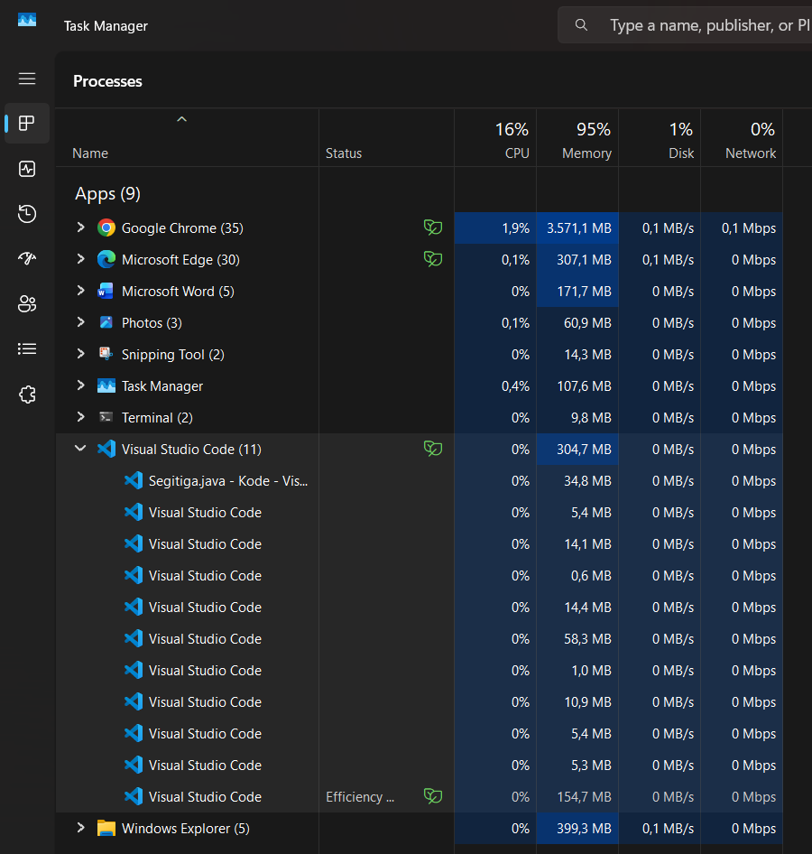

Sebelum proses dihentikan, penggunaan memori pada screenshot berada di sekitar 95%. Task Manager membantu mengidentifikasi aplikasi yang menggunakan sumber daya sistem.

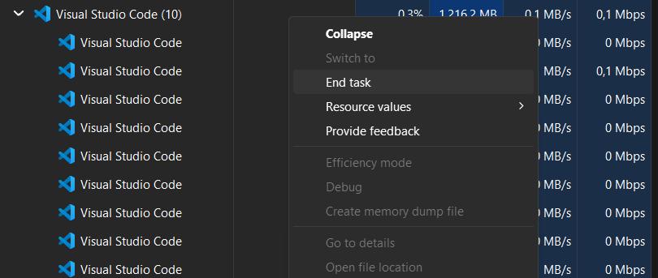

Setelah Visual Studio Code ditutup, aplikasi tersebut tidak lagi terlihat pada daftar aplikasi dan penggunaan memori pada screenshot turun menjadi sekitar 78%. Angka penggunaan dapat berubah sesuai kondisi komputer.

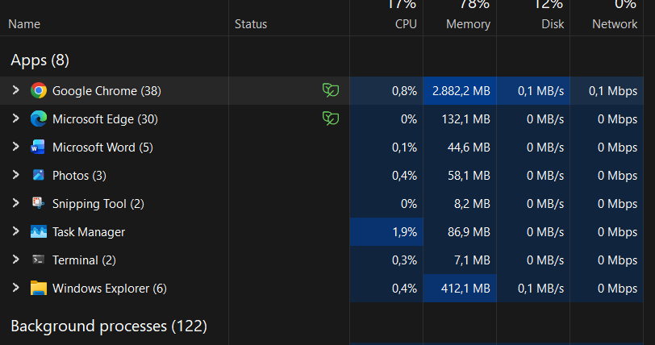

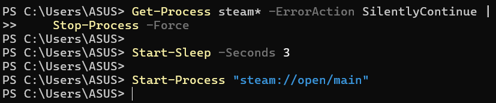

Screenshot kedua memperlihatkan rangkaian perintah yang sama dalam tampilan terminal yang berbeda.

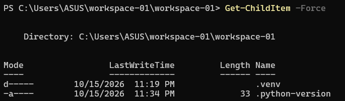

### 2.2 Memasang dan menyiapkan Python dengan `uv`

#### 2.2.1 Memasang dan memeriksa `uv`

Skrip instalasi dijalankan melalui PowerShell. Output menunjukkan bahwa program `uv`, `uvx`, dan `uvw` telah dipasang ke direktori lokal pengguna.

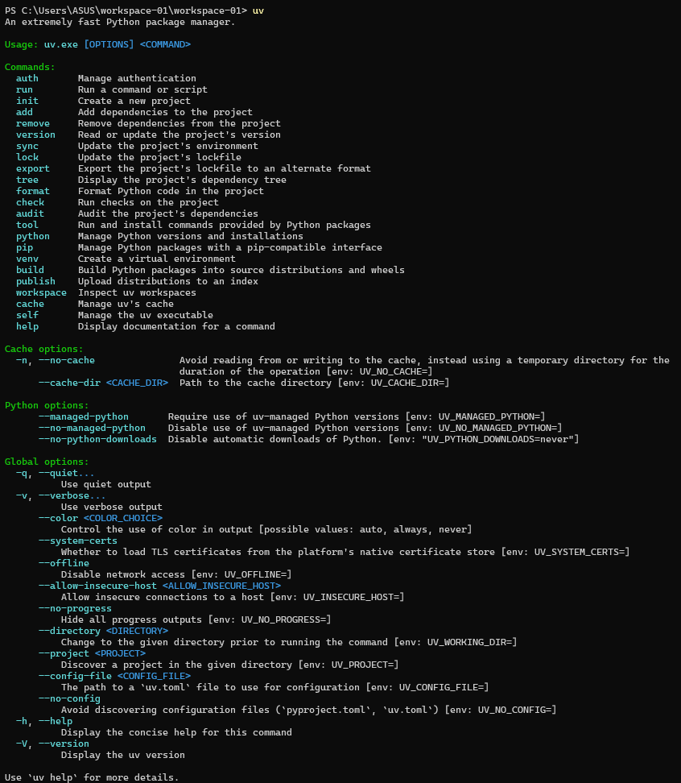

Perintah `uv --version` memastikan bahwa `uv` dapat ditemukan dan dijalankan dari terminal. Screenshot menampilkan versi `0.13.1` untuk Windows 64-bit.

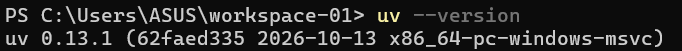

Perintah `uv self update` memeriksa pembaruan program. Pesan hasil pada screenshot menyatakan versi `0.13.1` sudah merupakan versi terbaru saat pemeriksaan.

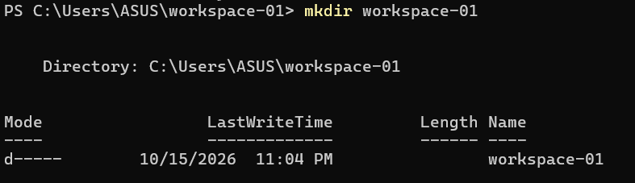

#### 2.2.2 Menyiapkan direktori proyek dan versi Python

Perintah `uv python list` menampilkan versi Python yang dapat dikelola oleh `uv` dan instalasi yang sudah ditemukan di komputer. Versi yang bertanda `<download available>` dapat diunduh apabila dibutuhkan.

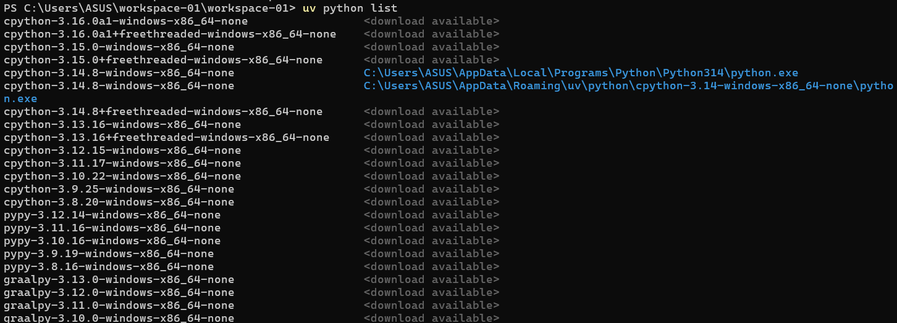

Perintah `mkdir workspace-01` membuat folder proyek. Pastikan folder tersebut belum ada sebelum menjalankan perintah yang sama kembali.


Perintah `cd workspace-01` berpindah ke folder proyek. Prompt PowerShell menunjukkan direktori aktif setelah perpindahan.

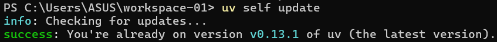

Perintah `uv python pin cpython-3.14.5-windows-x86_64-none` menetapkan CPython 3.14.5 sebagai versi proyek. Screenshot menunjukkan proses pengunduhan interpreter untuk Windows 64-bit.

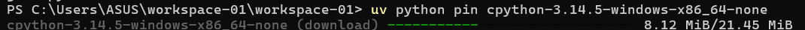

Screenshot ini menunjukkan percobaan menggunakan path `/home/bdpd/.local/bin/python3.14`, yang merupakan format path Linux. Terminal memperingatkan bahwa interpreter tidak ditemukan. Pada Windows, gunakan versi Python yang tersedia melalui `uv python list` atau path interpreter Windows yang sesuai.

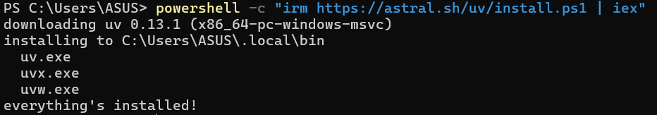

#### 2.2.3 Membuat lingkungan virtual dan memasang paket

Perintah `uv venv` membuat lingkungan virtual pada folder `.venv`. Screenshot melaporkan penggunaan Python 3.14.8. Karena langkah sebelumnya mencoba menetapkan Python 3.14.5, periksa kembali versi yang digunakan lingkungan virtual agar sesuai dengan versi proyek yang diinginkan.

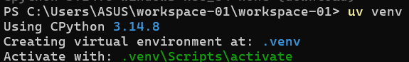

Perintah `Set-ExecutionPolicy RemoteSigned -Scope CurrentUser` mengubah kebijakan eksekusi PowerShell untuk akun saat ini. Pengaturan ini memungkinkan skrip aktivasi lokal dijalankan. Ubah kebijakan hanya jika diperlukan dan pahami cakupannya.

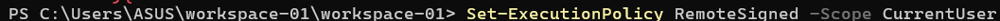

Perintah `uv pip install pandas` memasang paket `pandas` beserta dependensinya. Screenshot menunjukkan `pandas`, `numpy`, `python-dateutil`, `six`, dan `tzdata` berhasil dipasang. Jalankan perintah saat lingkungan proyek yang dimaksud sudah aktif agar paket terpasang di lingkungan yang tepat.

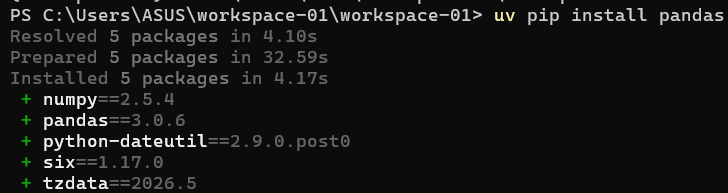

### 2.3 Membuat dan menjalankan server Strawberry GraphQL

#### 2.3.1 Memasang paket Strawberry GraphQL

Paket Strawberry GraphQL beserta fitur CLI dipasang dengan perintah berikut:

```powershell
uv pip install "strawberry-graphql[cli]"
```

Tanda kutip membantu PowerShell meneruskan bagian `[cli]` sebagai bagian dari nama paket. Output menunjukkan `uv` menyelesaikan dependensi dan memasang Strawberry GraphQL beserta paket pendukungnya.

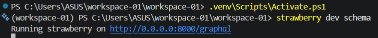

Perintah `uv pip install strawberry-graphql[cli]` pada screenshot lain menunjukkan pemeriksaan paket selesai. Hasil ini melengkapi bukti pemasangan paket dan fitur CLI di lingkungan yang sedang digunakan.

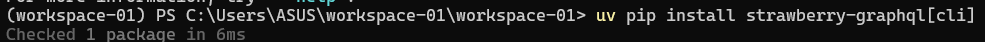

#### 2.3.2 Tugas 1: Membuat schema GraphQL

Buat file `schema.py` menggunakan Strawberry dengan ketentuan berikut:

1. Definisikan tipe GraphQL `Book` dengan field `title` dan `author`, keduanya bertipe teks.
2. Buat tipe `Query` yang menyediakan field `books` dan mengembalikan daftar objek `Book`.
3. Isi daftar dengan data buku contoh *The Great Gatsby* karya F. Scott Fitzgerald.
4. Buat schema Strawberry dengan `Query` sebagai root query.

**Hasil yang diharapkan:** schema dapat digunakan oleh server Strawberry dan menyediakan query `books` dengan informasi judul serta penulis.

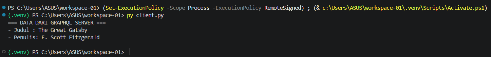

#### 2.3.3 Menjalankan server dan mencoba GraphiQL

Perintah pada screenshot mengaktifkan `.venv` lalu menjalankan `strawberry dev schema`. Server melaporkan alamat `http://0.0.0.0:8000/graphql`. Untuk mengaksesnya dari komputer yang sama, buka `http://127.0.0.1:8000/graphql` di browser.

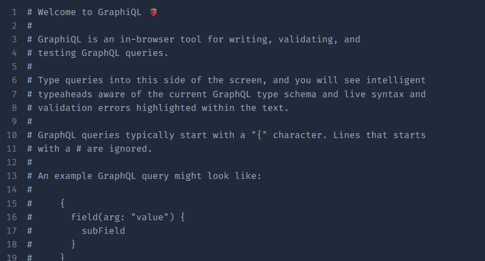

GraphiQL adalah antarmuka di browser untuk menulis, memvalidasi, dan mencoba query GraphQL. Screenshot berikut menunjukkan tampilan pengenalan editor GraphiQL.

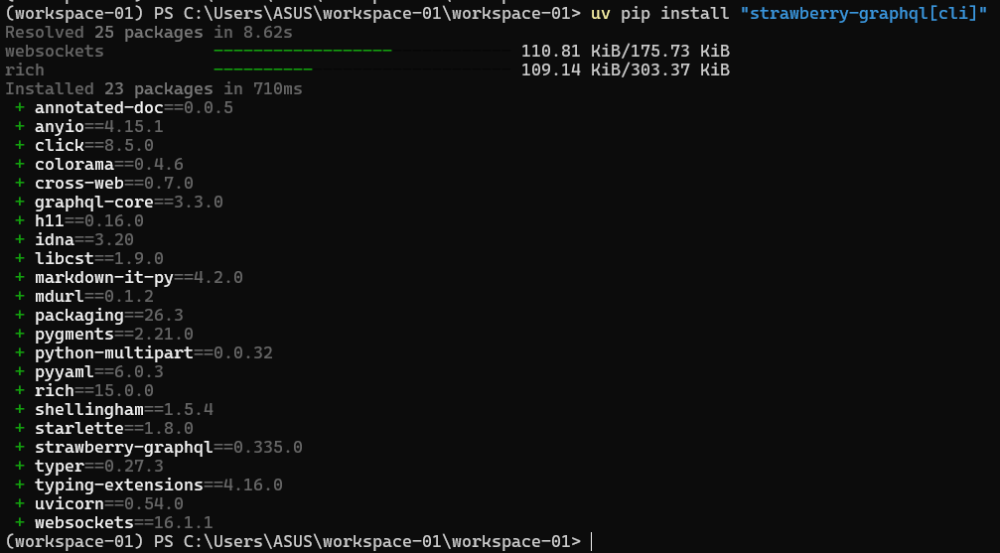

Query berikut meminta field `title` dan `author` dari setiap item pada `books`:

```graphql
{
  books {
    title
    author
  }
}
```

Hasil pada GraphiQL menampilkan objek buku dengan judul *The Great Gatsby* dan penulis F. Scott Fitzgerald. Ini membuktikan query dapat membaca data yang disediakan schema.

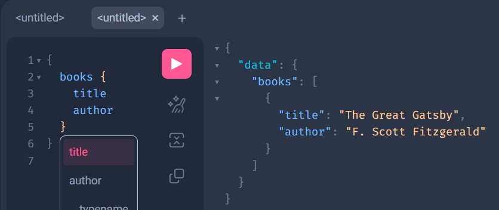

#### 2.3.4 Tugas 2: Membuat klien Python untuk menguji GraphQL

Buat file `client.py` untuk mengirim query GraphQL ke server Strawberry yang sedang berjalan. Klien harus meminta field `title` dan `author` dari query `books`, mengirim permintaan ke endpoint GraphQL lokal, lalu menampilkan data buku yang diterima dengan format yang mudah dibaca.

Jalankan server terlebih dahulu, pastikan lingkungan virtual aktif, kemudian uji klien dari terminal:

```powershell
py client.py
```

**Hasil yang diharapkan:** terminal menampilkan data dari server GraphQL, termasuk judul *The Great Gatsby* dan penulis F. Scott Fitzgerald. Hasil tersebut seharusnya sesuai dengan query yang dicoba melalui GraphiQL.

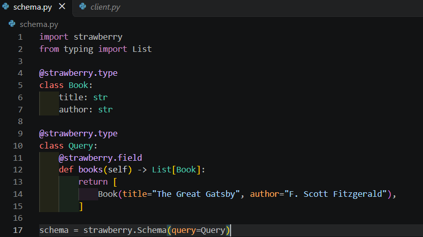

### 2.4 Menghentikan dan membuka kembali Steam

Kedua screenshot berikut menunjukkan kegiatan tambahan yang tidak terkait langsung dengan Python. Perintah `Get-Process steam* -ErrorAction SilentlyContinue | Stop-Process -Force` menghentikan proses Steam yang ditemukan. `Start-Sleep -Seconds 3` memberi jeda sebelum `Start-Process "steam://open/main"` meminta Steam membuka halaman utama kembali.

## 3. Kesimpulan

`uv` membantu memasang dan memeriksa Python, mengelola versi proyek, membuat lingkungan virtual, dan memasang dependensi. Setelah lingkungan siap, Strawberry GraphQL dapat digunakan untuk mendefinisikan schema, menjalankan server, dan menguji query melalui GraphiQL maupun klien Python. Pastikan interpreter yang dipakai sesuai sistem operasi serta lingkungan virtual yang aktif adalah lingkungan proyek yang benar.
