

# Praktikum Minggu 04
## Konsistensi dan Replikasi pada Sistem Terdistribusi

**Laporan Praktikum · Sistem Terdistribusi**

> Praktikum ini membandingkan replikasi **primary–standby PostgreSQL** dengan distribusi data pada **cluster Apache Ignite 3**.

## Tujuan Praktikum

- Memahami peran replikasi dalam meningkatkan ketersediaan data.
- Mengamati aliran WAL dari primary PostgreSQL ke replica.
- Menguji promosi replica secara manual saat primary berhenti.
- Mengoperasikan cluster Apache Ignite 3 dan membaca data dari node yang berbeda.

## Dasar Teori

### Konsistensi dan replikasi

Sistem terdistribusi menyimpan atau memproses data pada beberapa proses atau mesin yang berkomunikasi. **Replikasi** membuat salinan data di beberapa node agar ketersediaan meningkat dan layanan dapat bertahan saat node mengalami gangguan. Sistem tetap perlu mengatur bagaimana perubahan disebarkan agar salinan tidak menyimpang.

**Konsistensi** berkaitan dengan kesesuaian data yang dibaca dari node berbeda terhadap perubahan yang telah diterima sistem. Pada replikasi asinkron, perubahan mungkin belum sampai ke replica ketika primary gagal. Karena itu, failover manual tidak menjamin kehilangan data nol atau bahwa semua replica selalu sama pada saat yang persis sama.

### PostgreSQL streaming replication

PostgreSQL mencatat perubahan basis data pada **Write-Ahead Log (WAL)**. Pada streaming replication fisik, primary mengirimkan rekaman WAL ke standby, lalu standby menerapkannya agar salinan fisiknya mengikuti primary. Standby berada dalam mode recovery dan, pada konfigurasi praktikum ini, melayani koneksi baca.

`pg_basebackup` menyalin keadaan awal primary untuk menyiapkan standby. **Replication slot** membantu primary mempertahankan WAL yang belum dikonfirmasi replica. Parameter seperti `wal_level`, `max_wal_senders`, dan `hot_standby` mendukung konfigurasi ini. Status koneksi diperiksa melalui `pg_stat_replication`, sedangkan slot dapat dilihat melalui `pg_replication_slots`.

Standby dapat dipromosikan secara manual dengan `pg_promote()` saat primary gagal. Ini hanya demonstrasi failover, bukan konfigurasi high availability lengkap: pemilihan primary, pengalihan aplikasi, pencegahan dua primary aktif (*split-brain*), serta penggabungan kembali server lama membutuhkan mekanisme tambahan.

### Apache Ignite 3

Apache Ignite 3 membagi data ke dalam **partisi** dan menempatkan salinan partisi pada node cluster. **Distribution zone** menentukan pengaturan seperti jumlah replica dan partisi untuk tabel. Praktikum mendefinisikan zona dengan `replicas=2` dan `replicas=3`; penempatan aktual juga dipengaruhi jumlah node aktif dan keanggotaan cluster.

Tabel dapat menggunakan **colocation** untuk menempatkan data terkait berdasarkan kolom kunci yang sama, sehingga operasi atas data tersebut dapat berjalan lebih efisien. SQL digunakan untuk membuat skema, memuat data, membaca metadata, dan menjalankan agregasi. Tidak seperti model primary–standby PostgreSQL, Ignite mendistribusikan partisi dan replica di antara node.

## Pembahasan Langkah Praktikum

> Gambar ditampilkan langsung di bawah penjelasan setiap langkah. Klik gambar untuk melihat ukuran aslinya.

### A. PostgreSQL Streaming Replication

#### 1. Persiapan Docker dan konfigurasi

#### Langkah 01 — Memilih konfigurasi Docker Desktop

<a href="Images/01_Install_Docker.png">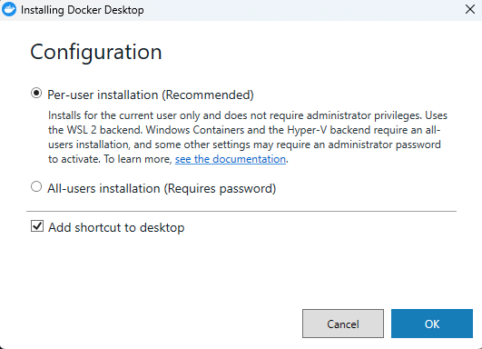</a>

*Pilihan instalasi Docker Desktop per pengguna Windows.*

**Pembahasan:** Opsi instalasi per pengguna memasang Docker Desktop hanya untuk akun Windows yang sedang digunakan dan tidak memerlukan hak administrator. Pilihan ini menyiapkan Docker Desktop sebagai lingkungan untuk menjalankan container praktikum. Dengan memilih cakupan instalasi yang sesuai, Docker dapat digunakan oleh akun praktikum tanpa mengubah pemasangan untuk seluruh pengguna komputer.

#### Langkah 02 — Memasang Docker Desktop

<a href="Images/02_Install_Docker.png">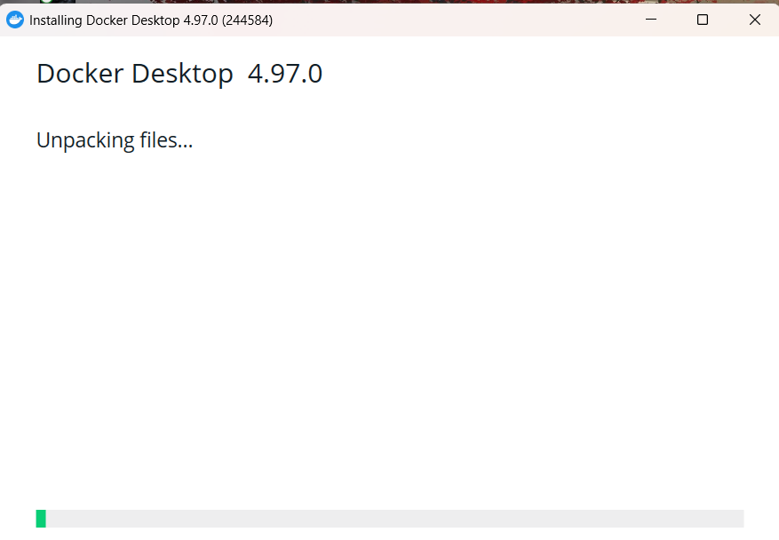</a>

*Proses ekstraksi dan pemasangan berkas Docker Desktop.*

**Pembahasan:** Layar ini menunjukkan proses ekstraksi berkas Docker Desktop setelah konfigurasi instalasi dipilih. Tunggu hingga proses selesai sebelum menggunakan perintah Docker dari terminal. Setelah instalasi selesai, Docker Desktop perlu dijalankan agar Docker Engine aktif dan siap menerima perintah dari terminal.

#### Langkah 03 — Memeriksa versi Docker

<a href="Images/03-Cek_Versi_Docke.png">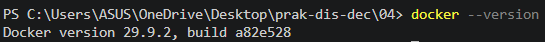</a>

*Keluaran pemeriksaan versi Docker CLI di terminal.*

**Pembahasan:** Perintah `docker --version` menampilkan versi Docker CLI yang terpasang, sehingga dapat dipastikan perintah `docker` dikenali oleh terminal. Versi pada tangkapan layar menjadi bukti bahwa instalasi CLI berhasil. Pemeriksaan versi ini menjadi validasi awal sebelum Compose digunakan untuk membuat lingkungan PostgreSQL.

#### Langkah 04 — Memeriksa versi Docker Compose

<a href="Images/04_Cek_Versi_Compose.png">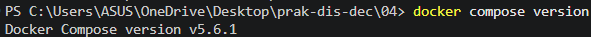</a>

*Keluaran pemeriksaan versi Docker Compose.*

**Pembahasan:** Perintah `docker compose version` menampilkan versi plugin Compose yang tersedia. Compose diperlukan agar definisi beberapa service PostgreSQL dapat dijalankan bersama melalui satu berkas konfigurasi. Informasi versi juga membantu memastikan format perintah Compose yang dipakai sesuai dengan plugin yang terpasang.

#### Langkah 05 — Memeriksa informasi Docker

<a href="Images/05_01_Docker_Info.png">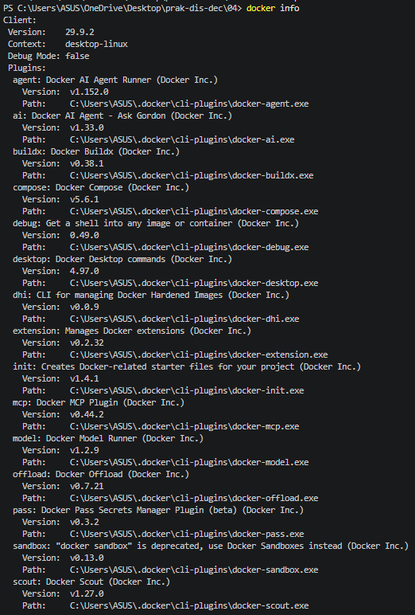</a>

<a href="Images/05_02_Docker_Info.png">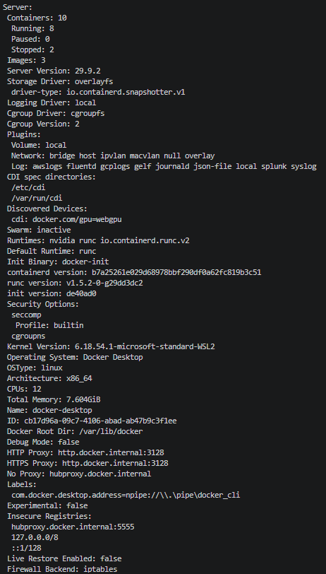</a>

*Informasi Docker dari sisi client dan Docker Engine/server.*

**Pembahasan:** Bagian client menampilkan versi Docker beserta plugin yang tersedia, sedangkan informasi server memperlihatkan keadaan Docker Engine dan lingkungan WSL. Kedua tangkapan layar ini saling melengkapi: CLI terpasang di sisi client dan engine aktif untuk menerima perintah. Pemeriksaan client dan server sekaligus membantu membedakan masalah pada perintah lokal dari masalah pada engine container.

#### Langkah 06 — Menyiapkan direktori kerja

<a href="Images/06_File_Direktori.png">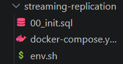</a>

*Isi direktori proyek streaming-replication.*

**Pembahasan:** Direktori `streaming-replication` menjadi lokasi kerja untuk berkas Compose, SQL inisialisasi, dan alias terminal. Memisahkan berkas praktikum dalam satu folder memudahkan Compose menemukan berkas yang dirujuk menggunakan path relatif. Menjalankan perintah dari direktori ini memastikan path relatif pada Compose dan skrip tetap mengarah ke berkas yang benar.

#### Langkah 07 — Membuat role dan replication slot

<a href="Images/07_File_00_init.sql.png">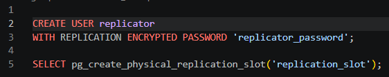</a>

*Skrip SQL untuk membuat role replikasi dan physical replication slot.*

**Pembahasan:** Skrip `00_init.sql` membuat user `replicator` dengan hak `REPLICATION`, agar replica dapat meminta WAL dari primary. Skrip juga membuat physical replication slot `replication_slot` yang membantu primary mempertahankan WAL yang diperlukan standby. Role khusus memisahkan kebutuhan autentikasi replikasi dari user aplikasi biasa, sementara slot mendukung pengiriman WAL berkelanjutan.

#### Langkah 08 — Mendefinisikan service PostgreSQL

<a href="Images/08_File_docker-compose_yml.png">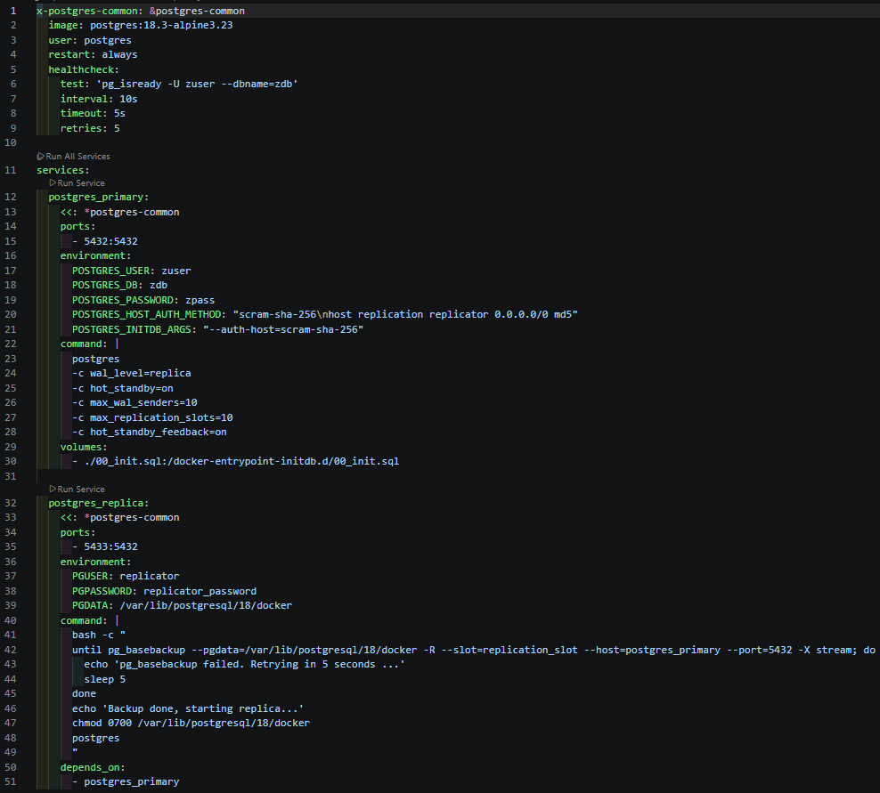</a>

*Konfigurasi Compose untuk service PostgreSQL primary dan replica.*

**Pembahasan:** Compose mendefinisikan dua service, yaitu `postgres_primary` dan `postgres_replica`, dengan konfigurasi umum serta health check. Primary mengaktifkan pengiriman WAL, sedangkan replica menjalankan `pg_basebackup` untuk mengambil salinan awal sebelum mulai sebagai standby. Pemetaan port memungkinkan primary dan replica diakses melalui port host yang berbeda. Pemisahan service memperjelas peran penulis data dan salinan standby, serta memudahkan keduanya dikelola sebagai satu proyek.

#### Langkah 09 — Menyiapkan alias terminal

<a href="Images/09_File_env_sh.png">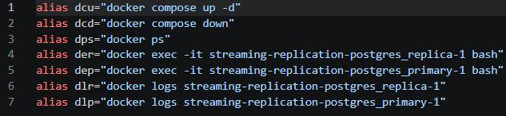</a>

*Daftar alias perintah pada berkas env.sh.*

**Pembahasan:** Berkas `env.sh` mendefinisikan alias seperti `dcu`, `dps`, `dep`, dan `dlr` untuk mempersingkat perintah yang sering digunakan. Alias tersebut memudahkan menjalankan Compose, melihat container, membuka shell, dan membaca log replica selama pengujian. Alias hanya berlaku pada shell tempat berkas dimuat, sehingga perlu dimuat kembali pada terminal baru.

#### Langkah 10 — Memeriksa isi direktori

<a href="Images/10_Cek_Direktori.png">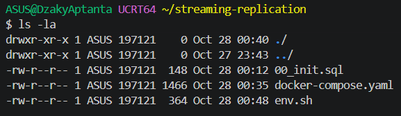</a>

*Daftar berkas praktikum hasil pemeriksaan direktori.*

**Pembahasan:** Perintah `ls -la` menampilkan isi folder, termasuk nama dan izin berkas konfigurasi. Pemeriksaan ini memastikan `00_init.sql`, `docker-compose.yaml`, dan `env.sh` tersedia sebelum service dijalankan. Dengan memeriksa nama berkas sebelum start, kesalahan path atau berkas konfigurasi yang belum tersedia dapat ditemukan lebih awal.

#### Langkah 11 — Menjalankan service

*Keluaran saat container primary dan replica mulai dijalankan.*

**Pembahasan:** Perintah `docker compose up -d` membaca konfigurasi, membuat jaringan proyek, lalu menyalakan container tanpa mengunci terminal. Keluaran menunjukkan image PostgreSQL digunakan dan kedua service berhasil dimulai. Mode detached membuat terminal tetap dapat digunakan untuk pemeriksaan lanjutan, sementara container berjalan di latar belakang.

#### Langkah 12 — Memuat alias ke shell

<a href="Images/12_Muat_env.png">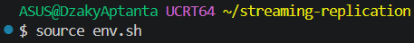</a>

*Perintah untuk memuat alias env.sh ke sesi shell.*

**Pembahasan:** Perintah `source env.sh` memuat definisi alias ke shell yang sedang aktif. Dengan begitu, perintah singkat seperti `dcu` dan `dps` dapat digunakan tanpa membuka sesi terminal baru. Langkah ini tidak menjalankan container baru; fungsinya hanya menyiapkan kemudahan perintah pada sesi shell.

#### Langkah 13 — Memeriksa kesehatan container

*Status dan port container PostgreSQL setelah dijalankan.*

**Pembahasan:** Kedua container berstatus `healthy`, yang menunjukkan pemeriksaan `pg_isready` berhasil pada database. Health check membuktikan server merespons, tetapi status streaming tetap harus dikonfirmasi melalui katalog statistik PostgreSQL. Pemeriksaan health check menjadi prasyarat yang baik sebelum menguji koneksi dan aliran replikasi antardatabase.

#### 2. Memeriksa replikasi dan menguji failover

#### Langkah 14 — Memastikan service berjalan

<a href="Images/14_dcu.png">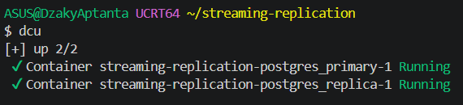</a>

*Keluaran alias dcu yang menunjukkan kedua service berjalan.*

**Pembahasan:** Alias `dcu` menjalankan `docker compose up -d` untuk memastikan service yang didefinisikan aktif. Keluaran menunjukkan primary dan replica berjalan, sehingga pengujian status replikasi dapat dilanjutkan. Tahap ini mengulang start secara aman dan memastikan lingkungan siap sebelum query verifikasi dijalankan.

#### Langkah 15 — Melihat container dan port

<a href="Images/15_dps.png">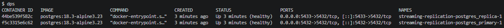</a>

*Daftar container, status, dan pemetaan port PostgreSQL.*

**Pembahasan:** Alias `dps` menjalankan `docker ps` dan menampilkan status serta nama container yang sedang hidup. Pemetaan host `5432` ke primary dan `5433` ke replica membedakan titik koneksi kedua server dari komputer host. Pemetaan port yang berbeda memungkinkan koneksi langsung ke masing-masing peran dari host untuk keperluan pengujian.

#### Langkah 16 — Memeriksa log replica

<a href="Images/16_dlr.png">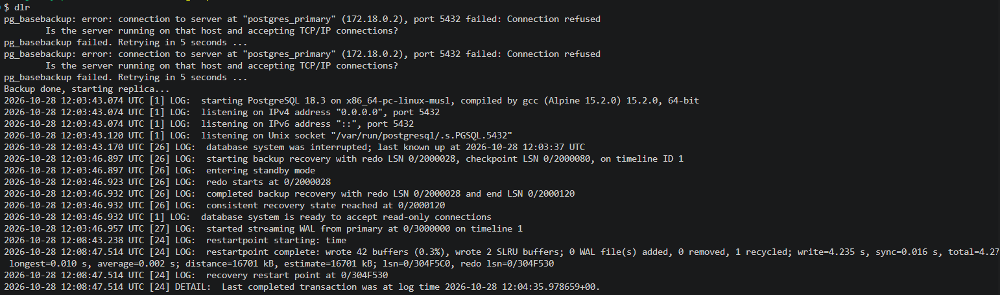</a>

*Log replica saat mengambil base backup dan memulai streaming WAL.*

**Pembahasan:** Log replica memperlihatkan `pg_basebackup` mencoba terhubung dan melakukan retry saat primary belum siap menerima koneksi. Setelah koneksi berhasil, standby menyelesaikan pemulihan dan mulai menerima WAL dari primary, sehingga keterlambatan awal tersebut tidak menghentikan proses. Retry pada proses bootstrap berguna karena container primary dan replica dapat mulai pada waktu yang tidak persis bersamaan.

#### Langkah 17 — Memeriksa koneksi streaming

<a href="Images/17_dep.png">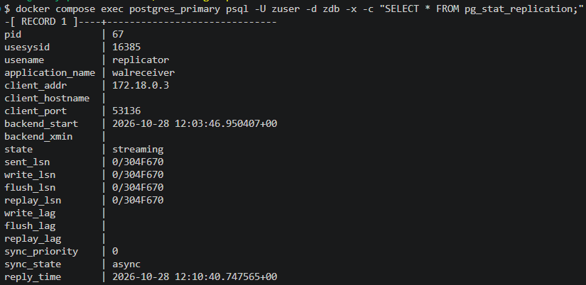</a>

*Baris pg_stat_replication yang menunjukkan koneksi streaming asinkron.*

**Pembahasan:** Query `pg_stat_replication` pada primary menampilkan koneksi dengan user `replicator` dan status `streaming`. Nilai `sync_state = async` menegaskan bahwa primary tidak menunggu replica mengonfirmasi setiap transaksi sebelum melanjutkan commit. Karena mode ini asinkron, transaksi terakhir masih berpotensi belum tersalin jika primary berhenti secara mendadak.

#### Langkah 18 — Memeriksa replication slot

<a href="Images/18_dep.png">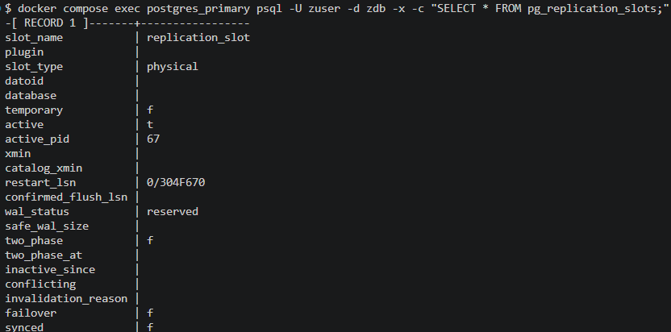</a>

*Informasi physical replication slot yang sedang aktif.*

**Pembahasan:** Query `pg_replication_slots` menunjukkan slot bernama `replication_slot` bertipe `physical` dan bernilai aktif. Hal ini mengindikasikan replica sedang memakai slot tersebut untuk mempertahankan posisi WAL yang diperlukan. Slot aktif membantu mencegah WAL yang belum diterima replica segera dibuang oleh primary.

#### Langkah 19 — Memastikan replica masih standby

<a href="Images/19_der.png">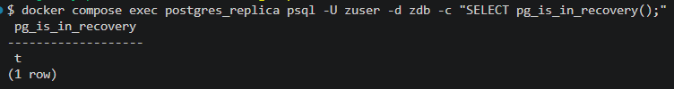</a>

*Hasil pg_is_in_recovery() pada server replica.*

**Pembahasan:** Fungsi `pg_is_in_recovery()` mengembalikan `t` saat dijalankan pada replica. Nilai ini memastikan node masih berada dalam recovery dan belum menerima operasi tulis seperti primary. Pemeriksaan ini membedakan standby dari primary dan membantu memastikan target koneksi query memang replica.

#### Langkah 20 — Menulis data pada primary

<a href="Images/20_Manipulasi_Data_Primary.png">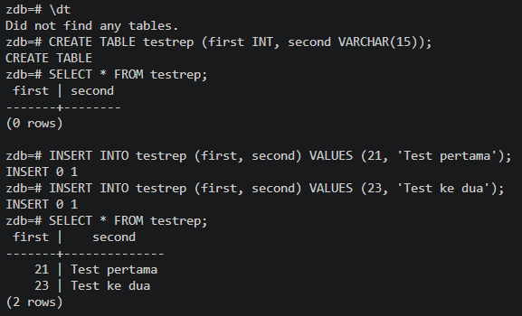</a>

*Pembuatan tabel uji, penambahan baris, dan hasil query pada primary.*

**Pembahasan:** Tabel `testrep` dibuat pada primary lalu diisi dua baris melalui perintah `INSERT`. Hasil `SELECT` menunjukkan data tersimpan di primary; pada replikasi fisik, perubahan tabel dan baris tersebut dicatat di WAL untuk diterapkan pada standby. Percobaan ini menyediakan perubahan nyata untuk diamati pada alur replikasi, bukan hanya memeriksa status koneksi.

#### Langkah 21 — Mensimulasikan kegagalan primary

<a href="Images/21_Primary_Server_Mati.png">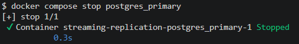</a>

*Keluaran penghentian container postgres_primary.*

**Pembahasan:** Perintah `docker compose stop postgres_primary` menghentikan container primary tanpa menghapus container atau datanya. Ini mensimulasikan kegagalan server utama dan menyiapkan pengujian promosi standby. Setelah primary berhenti, replica belum otomatis menerima peran penulis; promosi harus dilakukan secara eksplisit.

#### Langkah 22 — Mempromosikan replica

<a href="Images/22_Mempromosikan_replica_menjadi_primary.png">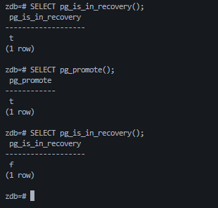</a>

*Promosi replica dan perubahan status recovery sesudah pg_promote().*

**Pembahasan:** Sebelum promosi, `pg_is_in_recovery()` bernilai `t`, menandakan server masih standby. Pemanggilan `pg_promote()` mengubah nilai berikutnya menjadi `f`, yang menunjukkan node telah keluar dari recovery dan menjadi primary baru. Perubahan status tersebut menjadi bukti bahwa peran server telah berganti, tetapi aplikasi tetap perlu diarahkan ke endpoint baru.

#### Langkah 23 — Menjalankan kembali Compose

<a href="Images/23_Mematikan_Primary_dan_Replika.png">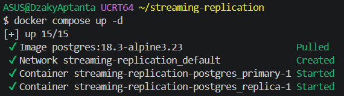</a>

*Keluaran saat service PostgreSQL dijalankan kembali dengan Compose.*

**Pembahasan:** Tangkapan layar menunjukkan `docker compose up -d` memulai kembali service dalam proyek. Menyalakan container saja tidak mengatur ulang peran pasca-failover, sehingga status kedua server dan arah replikasi harus diperiksa sebelum sistem digunakan kembali. Pemeriksaan peran setelah start ulang penting untuk menghindari dua server menerima penulisan secara bersamaan.

### B. Cluster Apache Ignite 3

#### 1. Menjalankan dan memeriksa cluster

#### Langkah 24 — Memeriksa struktur proyek

<a href="Images/24_Struktur_Direktori_ApacheIgnite.png">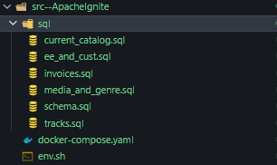</a>

*Struktur direktori proyek Apache Ignite dan berkas SQL.*

**Pembahasan:** Direktori proyek memisahkan konfigurasi cluster, alias terminal, dan skrip SQL dalam folder `sql`. Susunan ini memudahkan file skema dan data diakses dari CLI serta membantu menjaga konfigurasi cluster tetap terpisah dari data praktikum. Berkas SQL dapat dipasang ke container agar skrip tidak perlu disalin manual setiap kali cluster disiapkan.

#### Langkah 25 — Menjalankan tiga node Ignite

<a href="Images/25_dcu_Apache_ignit.png">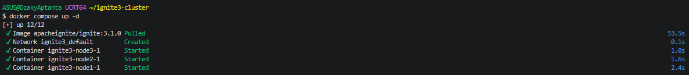</a>

*Keluaran Compose saat tiga node Apache Ignite dimulai.*

**Pembahasan:** Compose mengunduh image `apacheignite/ignite:3.1.0`, membuat jaringan, dan memulai tiga service node. Ketiganya memakai konfigurasi jaringan cluster yang sama agar dapat menemukan dan bergabung satu sama lain. Ketiga node menggunakan jaringan Compose yang sama, sehingga dapat berkomunikasi menggunakan nama service di jaringan internal.

#### Langkah 26 — Memeriksa node dan port

<a href="Images/26_dps_Apache_ignit.png">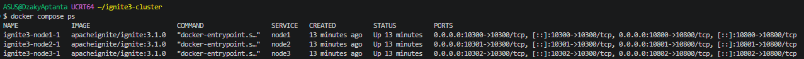</a>

*Daftar container Ignite dan pemetaan port tiap node.*

**Pembahasan:** Daftar container menunjukkan node1, node2, dan node3 berjalan menggunakan image Ignite yang sama. Port host dipetakan berbeda untuk setiap node, sehingga CLI dapat diarahkan ke node tertentu tanpa bentrok port. Pemeriksaan ini memastikan seluruh node berjalan sebelum CLI diarahkan ke salah satu endpoint cluster.

#### Langkah 27 — Memeriksa skrip dan alamat node

<a href="Images/27_Mengecek_ip.png">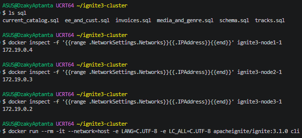</a>

*Daftar skrip SQL, alamat IP node, dan persiapan menjalankan CLI.*

**Pembahasan:** Langkah ini memastikan skrip SQL yang diperlukan tersedia dan menampilkan alamat IP internal masing-masing container. CLI kemudian dijalankan melalui jaringan host agar dapat terhubung ke endpoint Ignite yang dipublikasikan. Alamat yang terlihat membantu memverifikasi konektivitas, sedangkan pemetaan port menjadi jalur akses dari host.

#### Langkah 28 — Membuka Apache Ignite CLI

<a href="Images/28_Apache.png">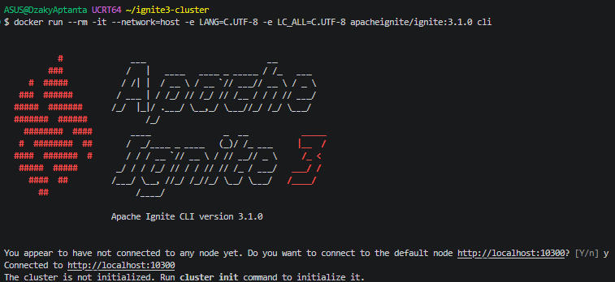</a>

*Tampilan CLI Ignite yang terhubung ke node1 sebelum cluster diinisialisasi.*

**Pembahasan:** CLI berhasil tersambung ke endpoint node1, sehingga konektivitas dasar ke service sudah teruji. Pesan bahwa cluster belum diinisialisasi berarti node dapat dijangkau, tetapi inisialisasi cluster tetap diperlukan sebelum operasi data dijalankan. Kondisi ini menunjukkan bahwa keberhasilan koneksi ke node dan kesiapan cluster adalah dua tahap yang berbeda.

#### Langkah 29 — Memeriksa status cluster

<a href="Images/29_Cluster_Status.png">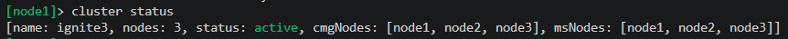</a>

*Status cluster Ignite yang aktif dengan tiga node.*

**Pembahasan:** Perintah `cluster status` menampilkan nama cluster, status `active`, dan tiga node yang terdaftar. Hasil ini mengonfirmasi bahwa node1, node2, dan node3 telah bergabung ke cluster sebelum skema dibuat. Status aktif menjadi titik awal untuk pembuatan zona, tabel, dan pemuatan data pada cluster.

#### 2. Membuat skema dan memuat data

#### Langkah 30 — Membuat zona dan tabel

<a href="Images/30_Schema.png">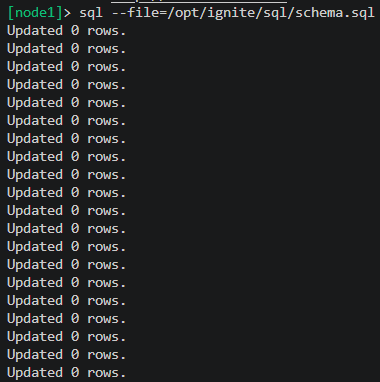</a>

*Eksekusi schema.sql untuk membuat distribution zone dan tabel.*

**Pembahasan:** Skrip `schema.sql` membuat ulang zona `Chinook` dan `ChinookReplicated`, lalu mendefinisikan tabel beserta primary key dan aturan colocation. Zona `Chinook` meminta dua replica, sedangkan `ChinookReplicated` meminta tiga replica dan 25 partisi. Keluaran CLI menunjukkan pernyataan skema berhasil diproses. Dengan menempatkan tabel ke zona berbeda, praktikum dapat membandingkan kebijakan jumlah salinan data.

#### Langkah 31 — Memuat data katalog

<a href="Images/31_Schema.png">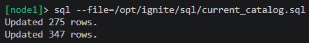</a>

*Eksekusi skrip current_catalog.sql untuk memuat data katalog.*

**Pembahasan:** Skrip `current_catalog.sql` memuat data katalog dasar yang digunakan dalam dataset praktikum. Jumlah baris yang dilaporkan CLI menjadi indikasi bahwa pernyataan insert/update pada berkas telah diproses. Data katalog berperan sebagai data referensi yang melengkapi tabel transaksi dan tabel terkait lainnya.

#### Langkah 32 — Memuat data employee dan customer

<a href="Images/32_Schema.png">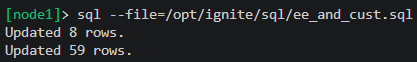</a>

*Eksekusi skrip ee_and_cust.sql untuk memuat data pegawai dan pelanggan.*

**Pembahasan:** Skrip `ee_and_cust.sql` memasukkan data employee dan customer ke tabel yang telah dibuat. Keluaran jumlah baris membantu memastikan kedua kelompok data diproses sebelum data transaksi dimuat. Data pelanggan dan pegawai menyediakan entitas yang dirujuk oleh data bisnis pada tahap berikutnya.

#### Langkah 33 — Memuat data invoice

<a href="Images/33_Schema.png">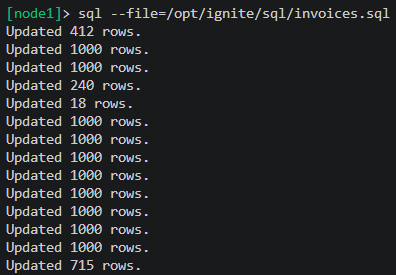</a>

*Eksekusi skrip invoices.sql untuk memuat data invoice.*

**Pembahasan:** Skrip `invoices.sql` mengisi data invoice dan detail transaksi melalui beberapa pernyataan. Keluaran `Updated ... rows` memperlihatkan pemrosesan dilakukan bertahap, yang sesuai untuk dataset dengan banyak baris. Keberhasilan pemuatan tabel transaksi menyediakan dataset untuk pengujian agregasi bulanan.

#### Langkah 34 — Memuat data media dan genre

<a href="Images/34_Schema.png">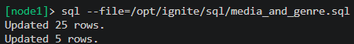</a>

*Eksekusi skrip media_and_genre.sql untuk memuat data media dan genre.*

**Pembahasan:** Skrip `media_and_genre.sql` mengisi tabel yang berkaitan dengan jenis media dan genre. Jumlah baris yang lebih sedikit dibanding invoice menunjukkan data referensi ini berukuran relatif kecil. Data referensi ini melengkapi informasi media dan genre yang digunakan oleh tabel musik.

#### Langkah 35 — Memuat data track

<a href="Images/35_Schema.png">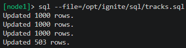</a>

*Eksekusi skrip tracks.sql untuk memuat data track.*

**Pembahasan:** Skrip `tracks.sql` memuat daftar track ke tabel yang telah dibuat pada zona distribusi. CLI menunjukkan pemrosesan dalam beberapa batch, sehingga dataset track dapat dimasukkan secara bertahap. Pemuatan track melengkapi isi dataset sehingga tabel-tabel utama dapat diperiksa bersama.

#### Langkah 36 — Memeriksa metadata tabel

<a href="Images/36_sql_Table.png">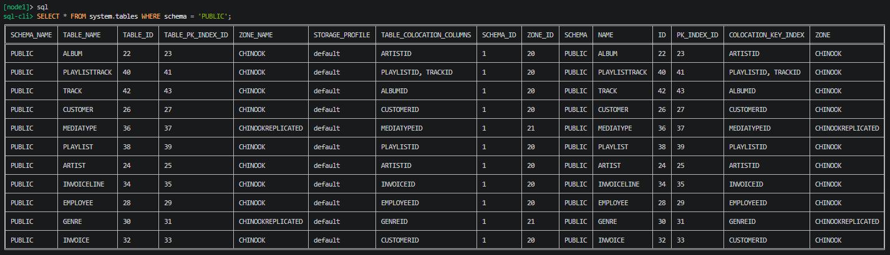</a>

*Hasil query metadata tabel, zona, dan kolom colocation.*

**Pembahasan:** Query metadata `system.tables` menampilkan nama tabel, zona, dan kolom colocation yang digunakan. Hasil menunjukkan `Genre` serta `MediaType` ditempatkan di `CHINOOKREPLICATED`, sementara tabel lain terlihat berada di `CHINOOK`. Ini memverifikasi bahwa definisi distribusi dari skrip skema diterapkan. Metadata ini memverifikasi konfigurasi logis tabel; hasilnya bukan tampilan langsung lokasi fisik setiap partisi.

#### 3. Menguji akses lintas node

#### Langkah 37–38 — Menjalankan dan melihat agregasi dari node3

<a href="Images/37_node2.png">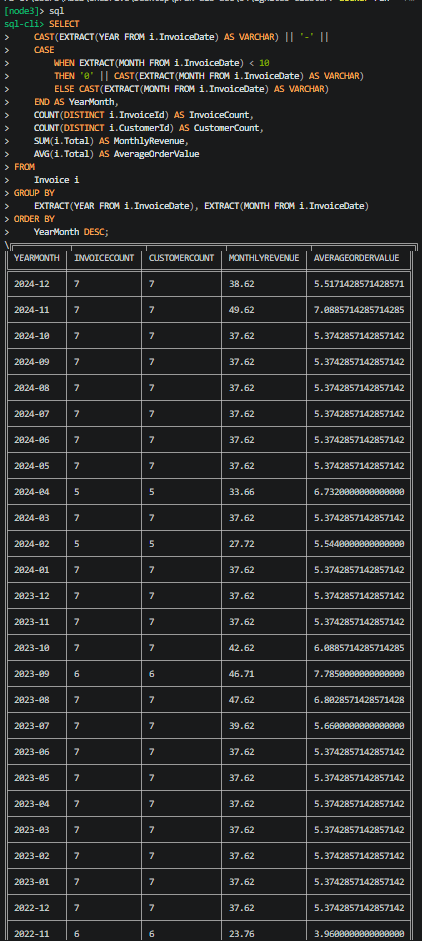</a>

<a href="Images/38_node2.png">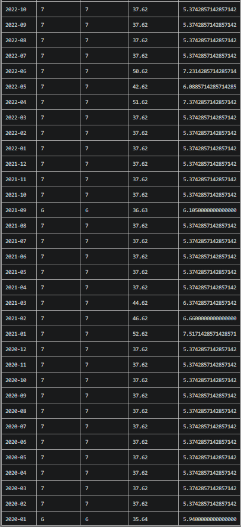</a>

*Query dan rangkaian hasil agregasi invoice bulanan dari node3.*

**Pembahasan:** Query SQL dijalankan dari koneksi node3 terhadap tabel `Invoice` dan mengelompokkan data menurut tahun serta bulan. Agregasi menghitung jumlah invoice, jumlah customer, pendapatan bulanan, dan rata-rata nilai transaksi, lalu mengurutkan periode terbaru lebih dahulu. Kedua gambar menampilkan query dan hasil lanjutannya sebagai satu rangkaian output. Hasil ini menjadi acuan untuk dibandingkan dengan eksekusi query yang sama setelah koneksi dipindah ke node2.

#### Langkah 39 — Menghubungkan CLI ke node2

<a href="Images/39_node3.png">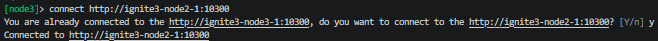</a>

*Konfirmasi CLI berpindah koneksi dari node1 ke node2.*

**Pembahasan:** Perintah `connect` meminta CLI tersambung ke alamat endpoint node2. Pesan konfirmasi menunjukkan koneksi sebelumnya berpindah dari node1 ke node2 tanpa perlu memulai ulang cluster. Perubahan koneksi hanya mengganti endpoint yang digunakan CLI; anggota cluster dan data di dalamnya tetap sama.

#### Langkah 40–41 — Menjalankan dan melihat kelanjutan agregasi dari node2

<a href="Images/40_node3.png">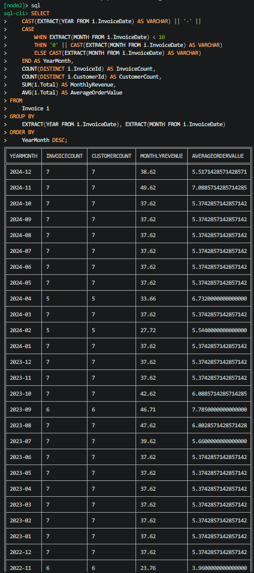</a>

<a href="Images/41_node3.png">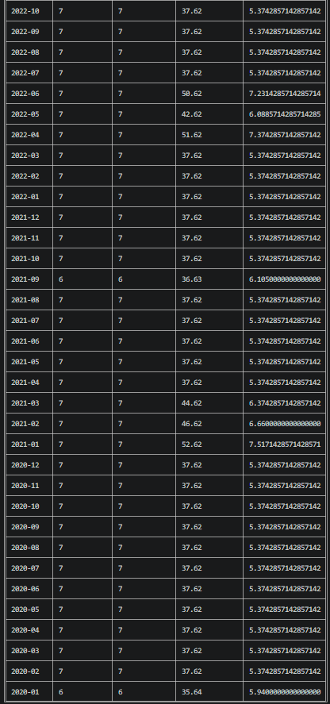</a>

*Query dan rangkaian hasil agregasi invoice bulanan dari node2.*

**Pembahasan:** Query agregasi yang sama dijalankan setelah CLI terhubung ke node2, dan hasilnya dapat dibandingkan dengan keluaran node3 untuk memastikan data cluster dapat diakses dari node berbeda. Tangkapan layar kedua melanjutkan tabel hasil yang terlalu panjang untuk satu gambar; keduanya merupakan satu rangkaian output query. Kesamaan hasil dari dua endpoint menunjukkan query dapat dilayani melalui node berbeda, meskipun bukan uji failover.

#### Langkah 42 — Menjalankan kembali container Ignite

<a href="Images/42_dcd.png">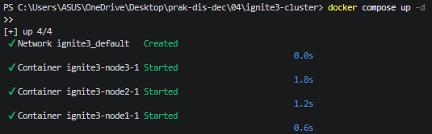</a>

*Keluaran Compose saat service cluster Ignite dijalankan kembali.*

**Pembahasan:** Perintah Compose pada terminal menyalakan kembali service Ignite yang tercantum dalam konfigurasi. Setelah proses tersebut, status cluster dan query sederhana sebaiknya diuji kembali untuk memastikan node kembali aktif dan data dapat diakses. Langkah akhir ini memeriksa bahwa definisi service masih dapat digunakan untuk menjalankan cluster kembali.

## Kesimpulan

Praktikum ini memperlihatkan penerapan konsistensi dan replikasi melalui dua teknologi dengan mekanisme yang berbeda. Pada PostgreSQL, perubahan data pada primary dicatat dalam Write-Ahead Log (WAL), kemudian dikirimkan kepada replica melalui streaming replication. Status koneksi, replication slot, dan mode recovery dapat diperiksa untuk memastikan replica mengikuti primary. Ketika primary dihentikan, replica dapat dipromosikan secara manual menggunakan `pg_promote()` agar mengambil peran sebagai server utama.

Pengujian PostgreSQL juga menunjukkan bahwa promosi replica tidak sama dengan failover otomatis. Karena replikasi berjalan secara asinkron, masih ada kemungkinan sebagian perubahan belum diterima replica saat primary mengalami gangguan. Setelah promosi, koneksi aplikasi dan peran server lama perlu dikelola dengan hati-hati untuk mencegah dua primary aktif sekaligus. Oleh sebab itu, penerapan nyata memerlukan pemantauan, pengalihan koneksi, serta prosedur pemulihan dan sinkronisasi ulang.

Pada Apache Ignite 3, tiga node berhasil membentuk cluster aktif dan dapat digunakan untuk membuat distribution zone, tabel, serta memuat dataset. Konfigurasi zona menentukan jumlah replica dan partisi, sedangkan colocation mengatur penempatan data terkait berdasarkan kunci tertentu. Metadata tabel menunjukkan zona yang dipakai, dan query agregasi invoice yang sama dapat dijalankan melalui node3 maupun node2. Hasil tersebut memperlihatkan bahwa data cluster dapat diakses melalui beberapa endpoint node.

Secara keseluruhan, praktikum membantu membedakan replikasi primary–standby PostgreSQL dari distribusi partisi dan replica pada Apache Ignite. Keduanya mendukung ketersediaan data, tetapi tingkat konsistensi dan cara pemulihannya ditentukan oleh konfigurasi, mode replikasi, serta perilaku sistem ketika terjadi gangguan. Karena pengujian Ignite berfokus pada status cluster dan akses query lintas node, hasil tersebut belum membuktikan ketahanan terhadap semua skenario kegagalan. Untuk sistem produksi, mekanisme failover, pemantauan lag, perlindungan dari split-brain, dan pengujian pemulihan perlu dirancang serta diuji secara terpisah.
