# LAPORAN PRAKTIKUM
## Modul 05 — Fault Tolerance

---

## 1. Tujuan Praktikum

Praktikum ini bertujuan untuk memahami dan menerapkan prinsip *fault tolerance* pada aplikasi web yang berjalan di lingkungan container dan menggunakan *load balancing*. Setelah menyelesaikan praktikum, mahasiswa diharapkan mampu:

- memahami konsep *fault tolerance* dan perannya dalam sistem terdistribusi;
- memeriksa ketersediaan layanan menggunakan *health check*;
- menerapkan mekanisme *retry* untuk menangani kegagalan sementara;
- menerapkan *circuit breaker* untuk membatasi permintaan ke layanan yang sedang bermasalah;
- mengonfigurasi Docker Compose dan Nginx untuk menjalankan beberapa instance aplikasi; serta
- mengamati dan menganalisis hasil pengujian berdasarkan tampilan maupun log aplikasi.

## 2. Dasar Teori

*Fault tolerance* adalah kemampuan suatu sistem untuk tetap menyediakan layanan ketika sebagian komponen mengalami kegagalan. Gangguan dapat berasal dari jaringan, proses aplikasi, atau layanan lain yang menjadi dependensi. Tanpa penanganan yang tepat, satu gangguan dapat memengaruhi komponen lain dan menyebabkan layanan tidak tersedia. Karena itu, sistem terdistribusi menggunakan beberapa strategi untuk mengurangi dampak kegagalan.

### 2.1 Retry

*Retry* adalah strategi mengulang permintaan yang gagal, terutama ketika kegagalan diperkirakan hanya sementara. Penerapan yang baik membatasi jumlah percobaan dan mengatur jeda antarpercobaan. Pada praktikum ini, pustaka Tenacity digunakan dengan *exponential backoff*, yaitu jeda yang bertambah secara bertahap. Pengaturan jeda membantu menghindari permintaan beruntun yang justru menambah beban layanan.

### 2.2 Circuit Breaker

*Circuit breaker* membatasi pemanggilan berulang terhadap layanan yang terus-menerus gagal. Setelah jumlah kegagalan melewati ambang yang ditentukan, *breaker* berpindah ke kondisi *open* dan menolak sementara permintaan berikutnya. Setelah waktu tunggu berakhir, mekanisme dapat mengizinkan percobaan kembali melalui kondisi *half-open*. Pola ini membantu layanan yang bermasalah pulih tanpa terus menerima beban dari permintaan yang kemungkinan besar akan gagal.

### 2.3 Health Check

*Health check* adalah pemeriksaan untuk mengetahui apakah suatu layanan dapat dijangkau atau siap digunakan. Script `check-server.py` pada praktikum memeriksa koneksi TCP ke host dan port yang diberikan. Hasil pemeriksaan memberi indikasi dasar bahwa port dapat dihubungi, tetapi tidak selalu membuktikan bahwa seluruh fungsi aplikasi berjalan dengan benar.

### 2.4 Load Balancing

*Load balancing* membagi permintaan masuk ke beberapa instance layanan. Nginx digunakan sebagai *reverse proxy* yang menerima permintaan dari client dan meneruskannya ke aplikasi `bs_app`. Menjalankan lebih dari satu instance dapat membantu membagi beban dan menyediakan replika layanan; perilaku ketika suatu instance gagal tetap bergantung pada konfigurasi proxy dan cara layanan menemukan backend.

### 2.5 Containerisasi dengan Docker

Docker mengemas aplikasi dan dependensinya ke dalam image sehingga aplikasi dapat dijalankan secara konsisten di berbagai lingkungan. Docker Compose digunakan untuk mendefinisikan layanan aplikasi dan Nginx dalam satu konfigurasi, menjalankannya bersama, serta mengatur jumlah instance aplikasi. Containerisasi mempermudah pengelolaan dan pengulangan proses deployment, tetapi tidak dengan sendirinya menjamin ketersediaan; konfigurasi dan pemantauan layanan tetap diperlukan.

## 3. Pembahasan

### Langkah 1 — Mengecek Versi Docker

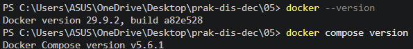

**Pembahasan :** Pada tahap awal, versi Docker diperiksa untuk memastikan perangkat lunak container tersedia dan dapat digunakan. Informasi versi juga membantu memastikan bahwa perintah dan konfigurasi yang dipakai sesuai dengan instalasi di komputer. Pemeriksaan ini menjadi langkah persiapan sebelum image dibangun dan container dijalankan.

### Langkah 2 — Masuk ke Direktori Kerja

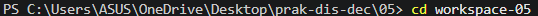

**Pembahasan :** Terminal diarahkan ke direktori kerja praktikum agar perintah berikutnya dijalankan pada lokasi proyek yang benar. Langkah ini penting karena Docker Compose, Dockerfile, dan berkas aplikasi berada di dalam struktur direktori proyek. Dengan berada di direktori yang sesuai, risiko kesalahan seperti berkas konfigurasi tidak ditemukan dapat dikurangi.

### Langkah 3 — Mengecek Daftar Python yang Tersedia

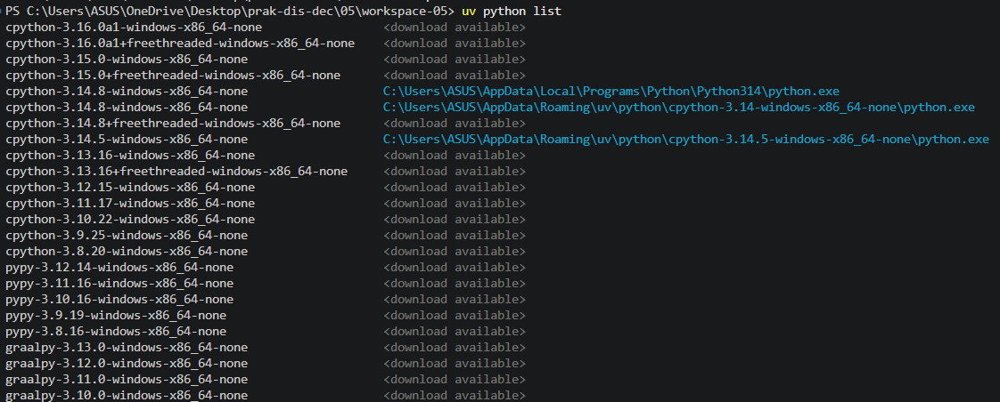

**Pembahasan :** Tahap ini bertujuan untuk mengetahui versi Python yang tersedia di sistem. Informasi ini penting karena proyek BlackSheep dan dependensinya memerlukan versi Python yang kompatibel. Setelah versi yang tersedia diketahui, interpreter yang sesuai dapat dipilih untuk membuat lingkungan virtual dan menjalankan aplikasi.

### Langkah 4 — Menginstal Python

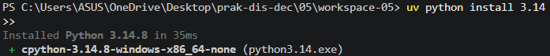

**Pembahasan :** Jika Python belum tersedia atau versinya belum sesuai dengan kebutuhan proyek, Python perlu dipasang terlebih dahulu. Instalasi menyediakan runtime yang akan digunakan untuk mengelola paket dan menjalankan aplikasi. Setelah proses selesai, ketersediaan Python sebaiknya diperiksa kembali agar tahap pembuatan lingkungan dan instalasi dependensi dapat dilakukan dengan benar.

### Langkah 5 — Melihat Struktur Direktori Kerja

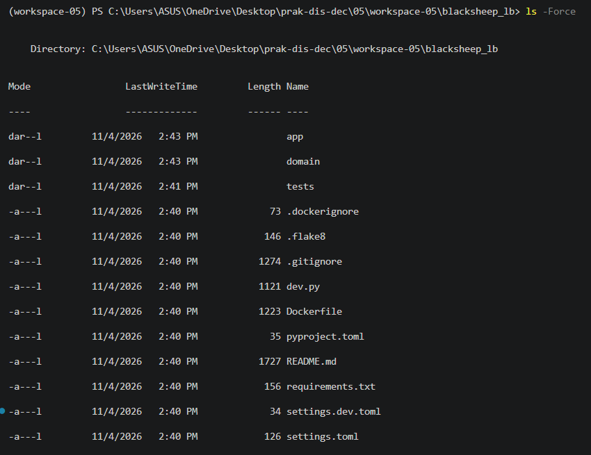

**Pembahasan :** Isi direktori kerja diperiksa untuk mengenali berkas dan folder yang telah tersedia. Struktur ini membantu menemukan lokasi proyek, konfigurasi, serta script pengujian yang akan digunakan pada langkah berikutnya. Memahami susunan direktori sejak awal juga mempermudah proses menjalankan perintah dari lokasi yang tepat.

### Langkah 6 — Membuat Virtual Environment dengan uv

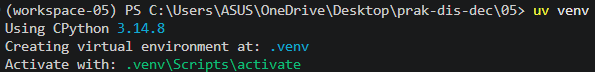

**Pembahasan :** Lingkungan virtual dibuat menggunakan `uv` agar paket yang dipasang untuk praktikum terpisah dari paket Python global. Pemisahan ini membantu menjaga konfigurasi proyek tetap rapi dan mengurangi kemungkinan konflik versi dengan proyek lain. Setelah lingkungan dibuat dan diaktifkan, instalasi dependensi dapat dilakukan secara lebih terisolasi.

### Langkah 7 — Instalasi BlackSheep

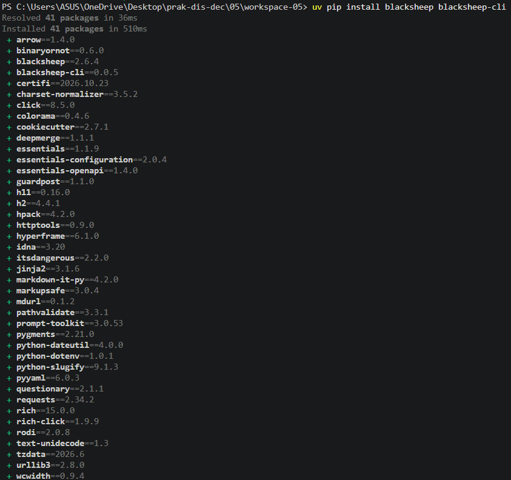

**Pembahasan :** BlackSheep dipasang di lingkungan virtual sebagai framework untuk membangun aplikasi web yang akan diuji. Instalasi ini menyediakan komponen dasar aplikasi, seperti server dan dukungan untuk menangani permintaan HTTP. Menempatkannya di lingkungan virtual memastikan paket tersebut tersedia pada konteks proyek tanpa mengubah instalasi Python global.

### Langkah 8 — Instalasi BlackSheep CLI

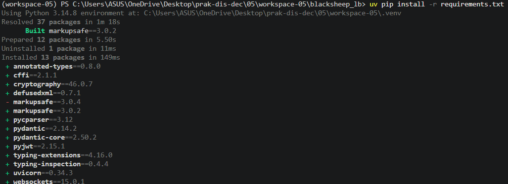

**Pembahasan :** BlackSheep CLI dipasang untuk membantu proses pembuatan proyek melalui perintah terminal. CLI menyediakan cara yang lebih praktis untuk menghasilkan struktur awal aplikasi dibandingkan membuat seluruh berkas secara manual. Struktur standar yang dihasilkan kemudian dapat digunakan sebagai dasar untuk konfigurasi dan pengujian aplikasi.

### Langkah 9 — Membuat Proyek Baru BlackSheep

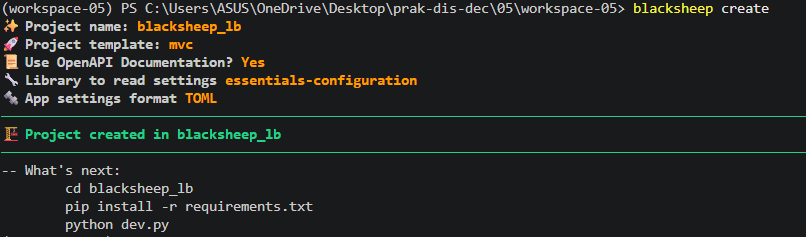

**Pembahasan :** Proyek BlackSheep dibuat sebagai aplikasi web yang akan menjadi backend dalam praktikum. Proses pembuatan ini menyiapkan struktur dasar, termasuk kode aplikasi dan berkas pendukungnya. Setelah proyek terbentuk, struktur tersebut perlu diperiksa dan aplikasi dijalankan secara lokal sebelum dimasukkan ke dalam container.

### Langkah 10 — Pengujian Aplikasi BlackSheep

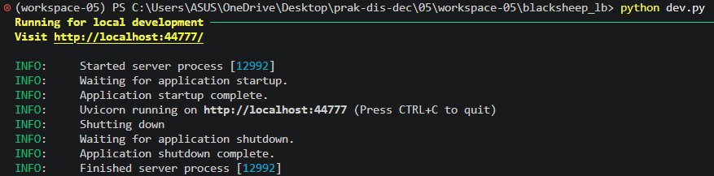

**Pembahasan :** Aplikasi dijalankan dalam mode pengembangan untuk memastikan server dapat dimulai tanpa kendala. Keberhasilan proses ini menunjukkan bahwa struktur proyek dan dependensi dasarnya telah tersedia. Respons aplikasi selanjutnya dapat diperiksa melalui browser; jika muncul kesalahan, terminal dapat digunakan untuk melihat informasi diagnostik.

### Langkah 11 — Membuka Browser untuk Menguji Tampilan

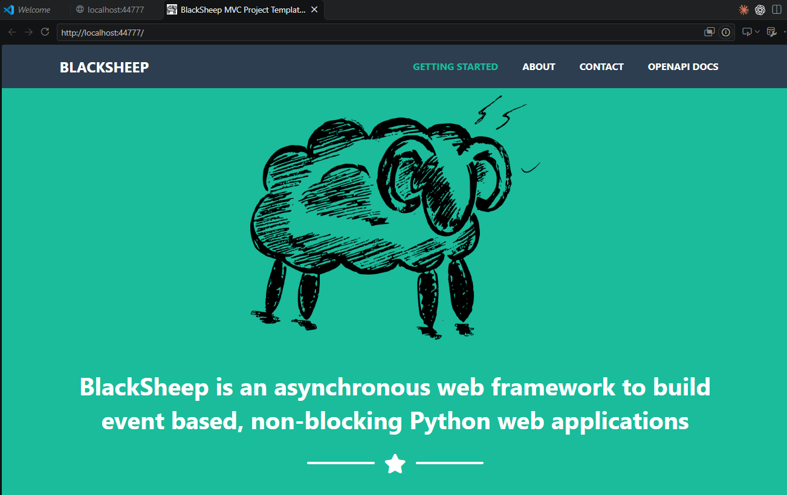

**Pembahasan :** Alamat aplikasi dibuka melalui browser untuk memverifikasi bahwa server dapat dijangkau dari sisi pengguna. Pemeriksaan ini melengkapi pengujian melalui terminal karena sekaligus memastikan halaman atau respons aplikasi dapat dimuat. Jika halaman tampil, aplikasi siap digunakan sebagai dasar untuk tahap containerisasi.

### Langkah 12 — Memeriksa Shell Setelah Pengujian Browser

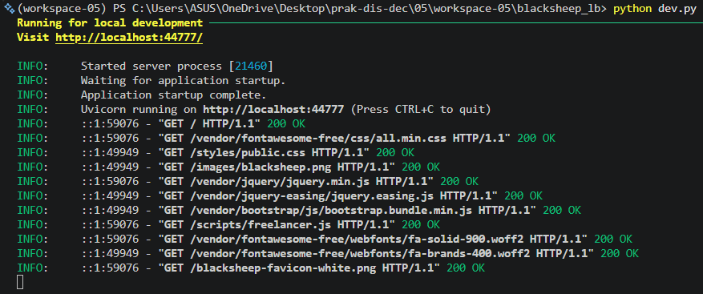

**Pembahasan :** Setelah browser mengakses aplikasi, terminal diperiksa untuk melihat log yang dihasilkan server. Log dapat menunjukkan permintaan yang masuk, status respons, atau pesan kesalahan. Mengamati log membantu menghubungkan aktivitas di browser dengan proses yang terjadi di sisi aplikasi.

### Langkah 13 — Memeriksa Struktur File Proyek

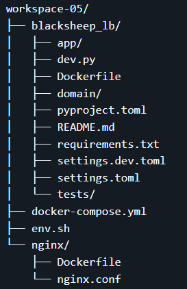

**Pembahasan :** Struktur file proyek ditinjau kembali sebelum konfigurasi Docker dibuat. Setiap komponen perlu berada pada lokasi yang sesuai agar Dockerfile dan konfigurasi layanan dapat merujuk ke berkas yang benar. Langkah ini juga membantu memahami pemisahan antara kode aplikasi, file konfigurasi, dan aset pendukung.

### Langkah 14 — Mengisi Dockerfile Aplikasi

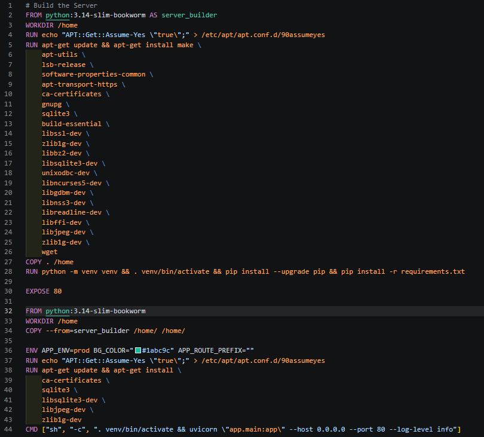

**Pembahasan :** Dockerfile aplikasi berisi instruksi untuk membangun image backend, seperti memilih image dasar, menentukan direktori kerja, menyalin berkas proyek, serta memasang dependensi. Instruksi tersebut menjelaskan bagaimana aplikasi disiapkan di dalam container. Dengan image ini, aplikasi dapat dijalankan dalam lingkungan yang lebih konsisten daripada hanya mengandalkan konfigurasi lokal.

### Langkah 15 — Membuat Folder Nginx

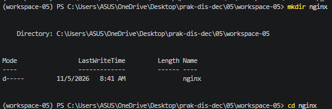

**Pembahasan :** Folder khusus Nginx dibuat untuk menempatkan Dockerfile dan konfigurasi reverse proxy secara terpisah dari kode aplikasi. Pemisahan ini membuat struktur proyek lebih mudah dipahami dan memudahkan pengelolaan setiap layanan. Nginx nantinya menerima permintaan dari client dan meneruskannya ke backend yang didefinisikan dalam konfigurasi.

### Langkah 16 — Mengisi Dockerfile Nginx

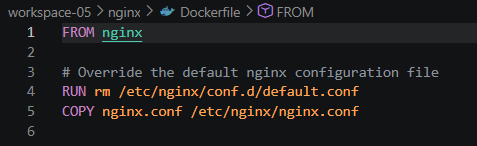

**Pembahasan :** Dockerfile Nginx digunakan untuk membangun image proxy yang akan berjalan sebagai layanan tersendiri. Di dalamnya ditentukan image dasar dan berkas konfigurasi yang diperlukan Nginx. Pemisahan container proxy dari container aplikasi membuat setiap komponen dapat dikelola dan dijalankan sesuai perannya.

### Langkah 17 — Mengisi Konfigurasi Nginx

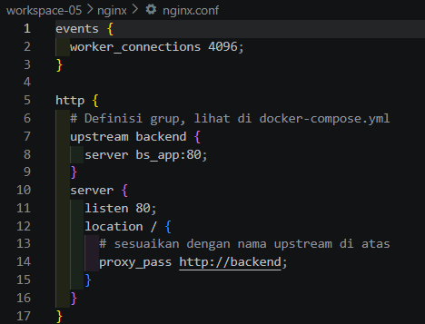

**Pembahasan :** File `nginx.conf` mendefinisikan upstream `backend` yang merujuk ke layanan `bs_app:80`, serta server yang menerima koneksi pada port 80. Dengan konfigurasi ini, client mengirim permintaan ke Nginx, lalu Nginx meneruskannya ke backend. Konfigurasi upstream menjadi bagian penting dalam menghubungkan proxy dengan layanan aplikasi.

### Langkah 18 — Membuat Konfigurasi Docker Compose

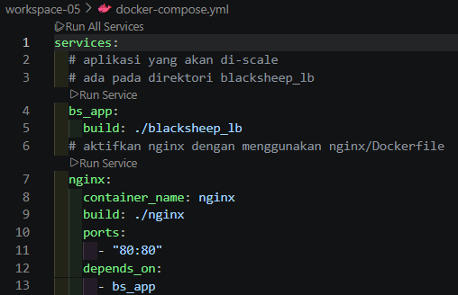

**Pembahasan :** Docker Compose digunakan untuk mendefinisikan layanan aplikasi dan Nginx beserta hubungan di antara keduanya. Pada konfigurasi ini, Nginx bergantung pada layanan aplikasi dan port 80 dipublikasikan agar dapat diakses dari host. Penggunaan Compose menyederhanakan proses menjalankan beberapa komponen sebagai satu kesatuan dan menjadi dasar untuk mengatur jumlah replika aplikasi.

### Langkah 19 — Mengisi File Environment

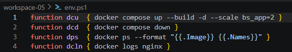

**Pembahasan :** File `env.sh` berisi alias perintah untuk memudahkan pengelolaan container, seperti menjalankan Compose dengan build dan skala tertentu, menghentikan layanan, memeriksa container, serta melihat log Nginx. Alias membuat perintah yang berulang lebih ringkas. Sebelum digunakan, file ini perlu dimuat ke shell agar alias tersedia pada sesi terminal.

### Langkah 20 — Menjalankan `dcu` untuk Scale Aplikasi

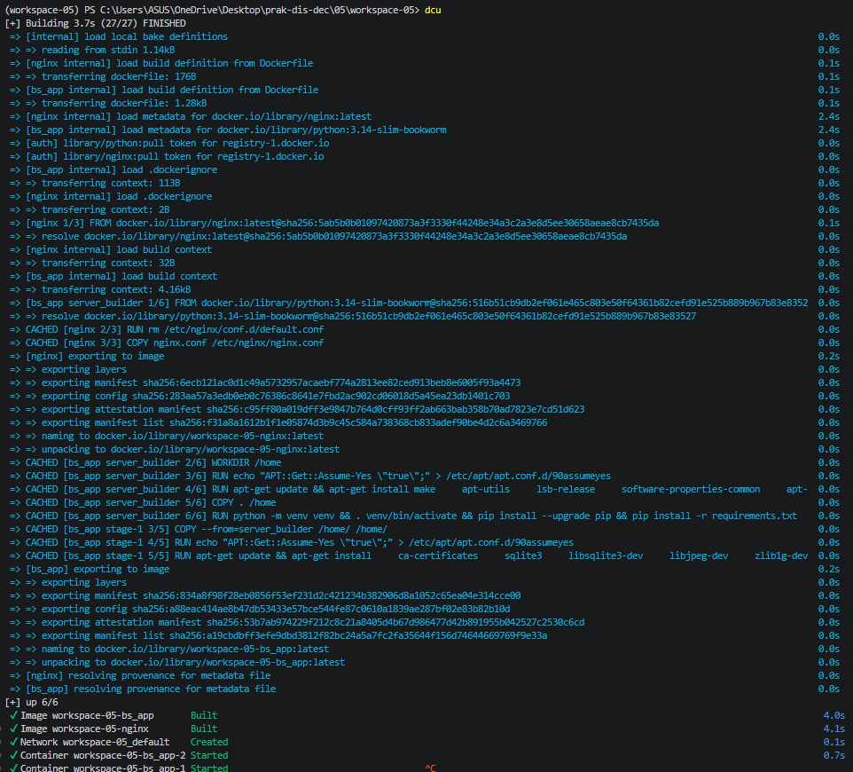

**Pembahasan :** Perintah `dcu` menjalankan layanan melalui Docker Compose sekaligus membangun image dan mengatur dua instance `bs_app`. Proses ini menyiapkan backend dalam bentuk replika serta menjalankan Nginx sebagai pintu masuk. Status container sebaiknya diperiksa setelah perintah selesai untuk memastikan layanan berhasil dibuat dan berjalan.

### Langkah 21 — Menguji Browser Setelah Scaling

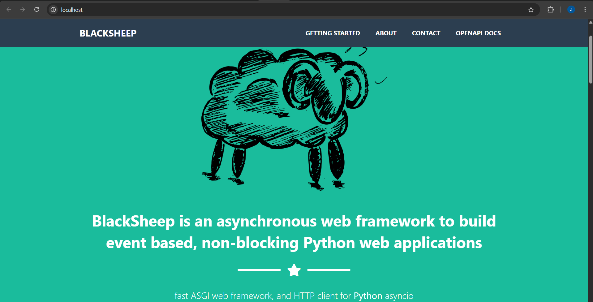

**Pembahasan :** Browser digunakan kembali untuk mengakses aplikasi melalui port yang dipublikasikan oleh Nginx. Pengujian ini memastikan jalur komunikasi dari client menuju proxy dan backend berfungsi setelah layanan dijalankan dalam beberapa instance. Respons yang berhasil menunjukkan bahwa aplikasi dapat diakses melalui susunan layanan yang telah dikonfigurasi.

### Langkah 22 — Melihat Log Request pada Kedua Replika

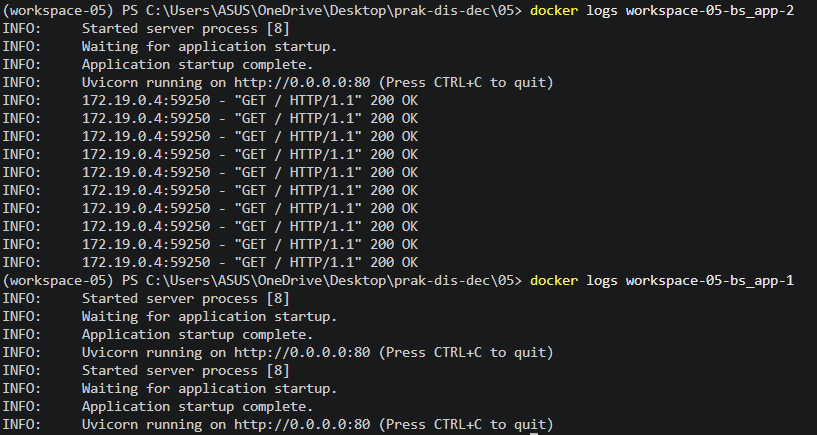

**Pembahasan :** Log container diperiksa untuk mengamati instance aplikasi yang menerima permintaan. Jika aktivitas terlihat pada kedua replika, hal tersebut menjadi indikasi bahwa permintaan telah didistribusikan di antara instance. Pengamatan log membantu memvalidasi konfigurasi sekaligus memberi pemahaman mengenai alur request melalui Nginx.

### Langkah 23 — Menghentikan Container dengan `dcd`

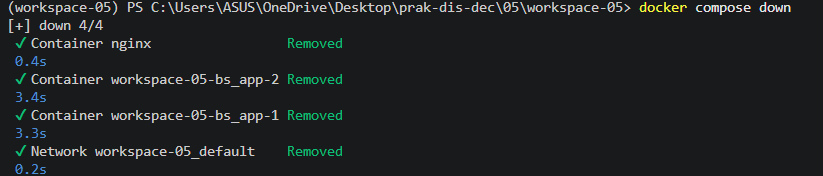

**Pembahasan :** Setelah pengujian load balancing selesai, perintah `dcd` digunakan untuk menghentikan layanan Compose. Penghentian yang teratur membebaskan resource yang digunakan dan mencegah container lama mengganggu tahap pengujian berikutnya. Langkah ini juga menandai peralihan dari pengujian infrastruktur menuju pengujian mekanisme penanganan kegagalan.

### Langkah 24 — Membuat Script Health Check `check-server.py`

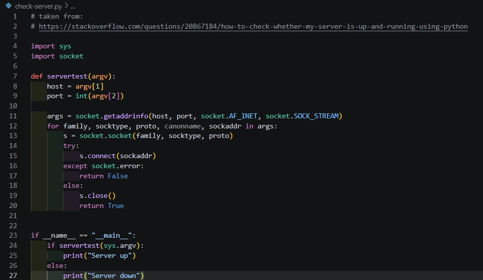

**Pembahasan :** Script `check-server.py` dibuat untuk mencoba koneksi TCP ke host dan port yang diberikan melalui argumen. Jika koneksi berhasil, script menampilkan `Server up`; jika koneksi gagal, hasilnya `Server down`. Pemeriksaan ini memberi indikasi apakah endpoint jaringan dapat dijangkau, tetapi belum menguji fungsi aplikasi secara menyeluruh.

### Langkah 25 — Menguji Heartbeat Server

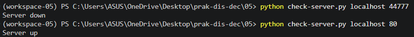

**Pembahasan :** Script heartbeat dijalankan untuk memeriksa status server pada host dan port yang ditentukan. Hasil `Server up` menandakan koneksi TCP berhasil dibuka, sedangkan `Server down` menunjukkan koneksi tidak berhasil. Pengujian ini memperlihatkan bagaimana pemeriksaan sederhana dapat digunakan untuk mengetahui ketersediaan jaringan layanan.

### Langkah 26 — Instalasi Library Tenacity

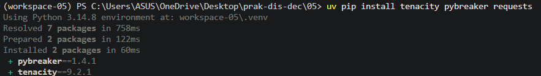

**Pembahasan :** Pustaka Tenacity dipasang untuk menambahkan dukungan pengulangan otomatis pada script permintaan HTTP. Pustaka ini menyediakan pengaturan jumlah percobaan, kondisi yang memicu pengulangan, dan jeda antarpercobaan. Setelah pemasangan, dependensi tersebut dapat digunakan dalam script retry untuk menguji skenario kegagalan sementara.

### Langkah 27 — Membuat Script Retry `check-retry.py`

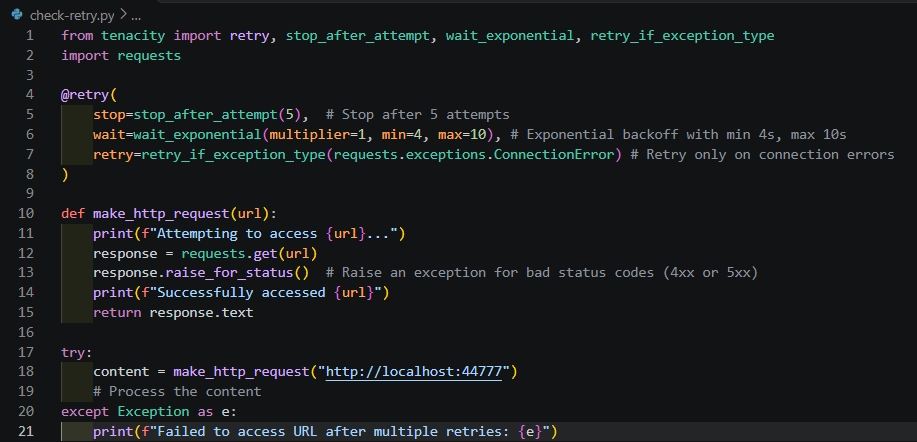

**Pembahasan :** File `check-retry.py` menggunakan Tenacity untuk mengulang permintaan ketika terjadi `ConnectionError`, dengan batas lima percobaan dan jeda *exponential backoff*. Jika koneksi berhasil, isi respons dapat diproses; jika semua percobaan gagal, kegagalan ditampilkan kepada pengguna. Pembatasan jumlah percobaan penting agar proses tidak berlangsung tanpa akhir.

### Langkah 28 — Membuat Script Circuit Breaker

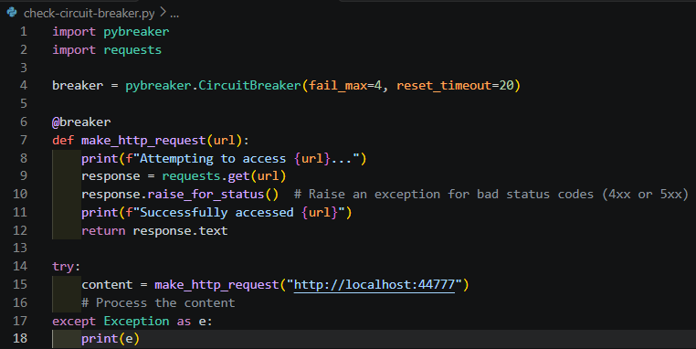

**Pembahasan :** Script `check-circuit-breaker.py` menggunakan pustaka `pybreaker` dengan ambang empat kegagalan dan waktu reset 20 detik. Fungsi permintaan HTTP diberi dekorator breaker sehingga kegagalannya dicatat oleh mekanisme tersebut. Ketika ambang tercapai, breaker dapat menolak pemanggilan sementara, sehingga aplikasi tidak terus-menerus mencoba menghubungi layanan yang gagal.

### Langkah 29 — Menguji Script Retry

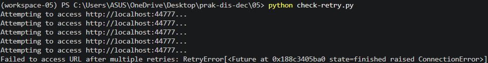

**Pembahasan :** Script retry dijalankan untuk mengamati upaya akses ke URL yang ditentukan. Jika layanan tidak tersedia, keluaran menunjukkan percobaan ulang sesuai jumlah dan jeda yang dikonfigurasi, sebelum akhirnya menampilkan kegagalan. Hasil ini memperlihatkan manfaat retry untuk gangguan sementara, sekaligus pentingnya membatasi percobaan agar beban tidak terus bertambah.

### Langkah 30 — Menguji Script Circuit Breaker

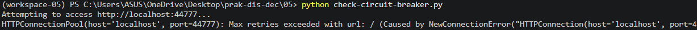

**Pembahasan :** Pada tahap akhir, script circuit breaker dijalankan untuk melihat respons mekanisme ketika permintaan HTTP gagal. Setelah jumlah kegagalan mencapai ambang, breaker membuka sirkuit dan membatasi permintaan berikutnya selama masa reset. Berbeda dari retry yang mencoba ulang satu operasi, circuit breaker berfokus mencegah pemanggilan berulang ketika layanan terus bermasalah.

## 4. Kesimpulan

Berdasarkan praktikum Modul 05 Fault Tolerance, dapat disimpulkan bahwa *fault tolerance* merupakan bagian penting dalam perancangan sistem berbasis layanan. Docker Compose dan Nginx membantu menjalankan serta menghubungkan beberapa komponen aplikasi, sementara replika backend memungkinkan pembagian request untuk diuji. Health check digunakan untuk memeriksa keterjangkauan layanan, retry membantu menangani kegagalan sementara, dan circuit breaker membatasi permintaan ketika kegagalan terjadi berulang kali.

Penerapan mekanisme tersebut perlu disertai konfigurasi yang tepat, batas percobaan yang wajar, serta pemantauan melalui log dan hasil pengujian. Dengan memahami fungsi dan batas setiap mekanisme, sistem dapat dirancang agar lebih tangguh dan lebih mampu mempertahankan layanan ketika sebagian komponennya mengalami gangguan.
