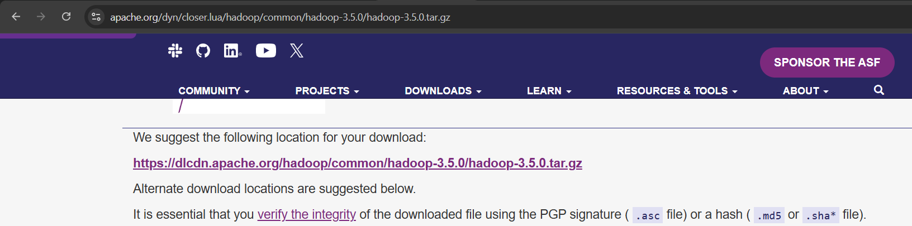
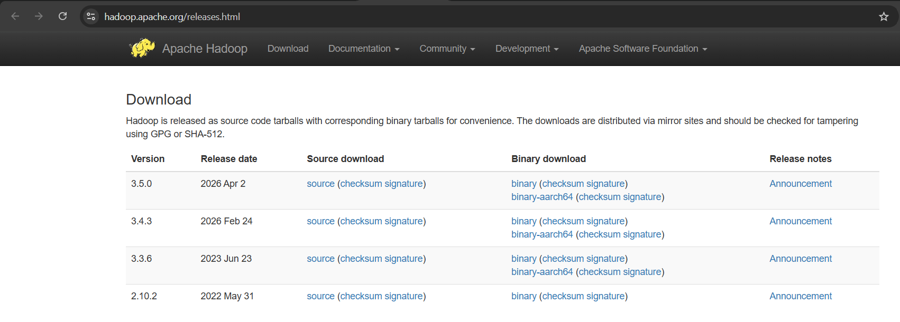
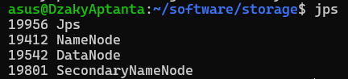

# Praktikum Sistem Terdistribusi dan Terdesentralisasi
### Modul 6: Distributed File System - HDFS

## 1. Latar Belakang

Distributed File System (DFS) adalah sistem penyimpanan data yang didistribusikan ke beberapa mesin atau node dalam jaringan. Data dapat disimpan, diakses, dan dikelola secara bersamaan tanpa bergantung pada satu komputer saja. Dalam lingkungan Big Data, sistem ini sangat penting karena data yang diproses biasanya berukuran sangat besar dan tidak mungkin disimpan hanya pada satu perangkat.

Hadoop Distributed File System (HDFS) merupakan implementasi DFS yang dikembangkan dalam ekosistem Apache Hadoop. HDFS dirancang untuk menyimpan data besar pada mesin-mesin yang saling terhubung dan relatif sederhana. Sistem ini mampu menangani data dalam jumlah besar, serta menawarkan skalabilitas, toleransi terhadap kegagalan, dan redundansi data.

HDFS terdiri atas beberapa komponen utama, yaitu NameNode, DataNode, block data, dan replikasi data. NameNode berperan sebagai node master yang mengelola metadata sistem file, sedangkan DataNode berfungsi sebagai node pekerja yang menyimpan data sebenarnya. Data dibagi dalam bentuk blok dan diduplikasi ke beberapa node untuk menjaga ketersediaan data jika terjadi kegagalan node tertentu.

## 2. Tujuan Praktikum

Tujuan dari praktikum ini adalah:

- memahami konsep dasar Distributed File System dan HDFS;
- memahami peran NameNode dan DataNode dalam sistem penyimpanan terdistribusi;
- menginstal dan mengonfigurasi Apache Hadoop serta komponen pendukungnya;
- memastikan konektivitas SSH dalam lingkungan single-node;
- menjalankan layanan HDFS dan mengecek status operasionalnya;
- mengunggah serta memverifikasi dataset dalam HDFS.

## 3. Dasar Teori

Distributed File System (DFS) merupakan pendekatan penyimpanan data yang membagi file ke beberapa node dalam jaringan. Dengan cara ini, data tidak hanya disimpan pada satu lokasi, tetapi terdistribusi di seluruh node yang terhubung. Keunggulan DFS adalah kemampuan untuk menangani data dalam ukuran besar, meningkatkan keandalan sistem, serta memudahkan pengelolaan data secara terpusat melalui metadata.

HDFS merupakan bagian dari ekosistem Apache Hadoop yang fokus pada penyimpanan data besar. Pada HDFS, data dipotong menjadi blok-blok tertentu dengan ukuran yang telah ditentukan. Setiap blok kemudian didistribusikan ke beberapa DataNode dan disalin ke node lain sesuai parameter replikasi. Dengan sistem ini, data tetap tersedia meskipun ada node yang mengalami gangguan.

Konfigurasi HDFS memerlukan beberapa komponen penting, seperti Java 17, SSH, variabel lingkungan, serta pengaturan file `core-site.xml` dan `hdfs-site.xml`. Setelah konfigurasi dilakukan, layanan NameNode dan DataNode dapat dijalankan untuk memastikan HDFS siap menerima permintaan penyimpanan dan akses data.

## 4. Langkah Kerja dan Pembahasan

### 4.1 Mengunduh Apache Hadoop

Pembahasan:
Tahap awal dilakukan pengunduhan Apache Hadoop versi 3.5.0 dari situs resmi. Proses ini penting karena Hadoop merupakan komponen utama yang akan dijalankan pada lingkungan praktikum. Setelah file arsip berhasil diunduh, langkah selanjutnya adalah menyiapkan direktori penyimpanan agar proses instalasi dapat dilakukan dengan rapi dan terorganisir.

### 4.2 Menyiapkan Direktori Penyimpanan

Pembahasan:
Setelah file unduhan tersedia, dibuat direktori khusus untuk menampung instalasi Hadoop. Pembagian direktori yang baik sangat penting agar file hasil unduhan, file konfigurasi, dan data kerja tidak bercampur dengan komponen sistem lain.

### 4.3 Membuat Direktori Penyimpanan

Pembahasan:
Pada langkah ini dibuat direktori baru yang akan digunakan sebagai lokasi utama pemasangan Hadoop. Direktori tersebut memudahkan proses ekstraksi dan pengelolaan file selama konfigurasi berlangsung.

### 4.4 Mengekstrak Arsip Hadoop

Pembahasan:
File arsip Hadoop diekstrak ke direktori yang telah dibuat. Proses ekstraksi menghasilkan struktur folder utama sistem Hadoop, termasuk file konfigurasi dan skrip yang digunakan untuk menjalankan layanan HDFS.

### 4.5 Memeriksa Direktori Hasil Ekstraksi dan Tautan Hadoop

Pembahasan:
Setelah ekstraksi selesai, dilakukan pengecekan isi direktori dan pembuatan tautan (symlink) agar Hadoop dapat diakses dengan path yang lebih sederhana. Hal ini memudahkan eksekusi perintah seperti `hadoop` dan `hdfs` tanpa harus selalu menuliskan lokasi yang panjang.

### 4.6 Mengecek Versi Hadoop

Pembahasan:
Perintah `hadoop version` digunakan untuk memastikan instalasi berhasil dan versi Hadoop yang digunakan sesuai dengan yang diharapkan. Jika output versi muncul di terminal, berarti instalasi dasar Hadoop telah berjalan dengan benar.

### 4.7 Menginstal Java 17, SSH, wget, dan pdsh

Pembahasan:
Hadoop berjalan di atas Java Virtual Machine (JVM), sehingga Java 17 harus tersedia di sistem. Selain itu, SSH digunakan untuk autentikasi dan komunikasi antar node, sedangkan `wget` dan `pdsh` berfungsi untuk mengunduh file dan menjalankan perintah secara efisien. Persiapan dependency ini merupakan fondasi utama agar Hadoop dapat berfungsi dengan optimal.

### 4.8 Menambahkan Variabel Lingkungan

Pembahasan:
Variabel lingkungan seperti `JAVA_HOME` dan `HADOOP_HOME` ditambahkan agar sistem dapat mengenali lokasi instalasi Java dan Hadoop. Dengan pengaturan ini, perintah Hadoop dan Java dapat dijalankan dari terminal secara global tanpa menuliskan path lengkap setiap kali.

### 4.9 Memuat Ulang Konfigurasi Shell

Pembahasan:
Setelah variabel lingkungan ditambahkan, konfigurasi shell dimuat ulang agar perubahan dapat langsung berlaku. Proses ini memastikan lingkungan baru aktif dan siap digunakan saat perintah Hadoop dieksekusi.

### 4.10 Membuat Kunci SSH

Pembahasan:
Pembuatan key SSH dilakukan agar mesin lokal dapat berkomunikasi tanpa password. Dalam konfigurasi single-node, SSH sangat penting untuk memastikan autentikasi berjalan aman dan otomatis.

### 4.11 Menambahkan Kunci Publik ke `authorized_keys`

Pembahasan:
Kunci publik yang telah dibuat kemudian dipindahkan ke file `authorized_keys` agar sistem dapat mengakses dirinya sendiri secara otomatis. Dengan demikian, proses autentikasi saat Hadoop mencoba berkomunikasi menjadi lebih stabil.

### 4.12 Mengatur Izin Berkas SSH

Pembahasan:
Setelah kunci ditambahkan, dilakukan pengaturan izin agar file dan direktori SSH aman serta dapat dibaca oleh sistem. Izin yang salah dapat menyebabkan koneksi SSH gagal walaupun kunci sudah dibuat dengan benar.

### 4.13 Menguji Koneksi SSH

Pembahasan:
Pengujian SSH dilakukan dengan login ke localhost. Jika koneksi berhasil, berarti konfigurasi autentikasi selesai dan layanan SSH siap digunakan untuk kebutuhan Hadoop.

### 4.14 Menambahkan Pengaturan Konfigurasi

Pembahasan:
Pada tahap ini dilakukan pengaturan konfigurasi Hadoop pada file seperti `core-site.xml`, `hdfs-site.xml`, `mapred-site.xml`, dan `yarn-site.xml`. Konfigurasi ini menentukan lokasi penyimpanan, replikasi data, dan endpoint default untuk lingkungan Hadoop.

### 4.15 Membuat Direktori Data NameNode dan DataNode

Pembahasan:
HDFS membutuhkan ruang penyimpanan untuk metadata NameNode dan blok data DataNode. Oleh karena itu, dibuat direktori khusus agar node dapat menyimpan data dan informasi penting secara terstruktur.

### 4.16 Mengatur Filesystem Bawaan dan Properti Proxy di `core-site.xml`

Pembahasan:
File `core-site.xml` mengatur filesystem default Hadoop (`fs.defaultFS`) serta properti proxy yang digunakan untuk mengakses layanan. Pengaturan ini sangat penting karena seluruh operasi HDFS merujuk ke endpoint default yang telah ditentukan.

### 4.17 Mengatur Replikasi dan Direktori di `hdfs-site.xml`

Pembahasan:
Pada file `hdfs-site.xml` diatur faktor replikasi data dan lokasi direktori NameNode serta DataNode. Dalam konfigurasi single-node, biasanya replikasi diatur menjadi 1 agar data tidak terlalu terduplikasi di lingkungan yang sederhana.

### 4.18 Memformat NameNode untuk Inisialisasi HDFS

Pembahasan:
Perintah `hdfs namenode -format` dijalankan untuk menginisialisasi metadata HDFS. Proses ini dilakukan pada saat pertama kali HDFS dibangun agar sistem file dapat diatur secara awal dan siap menerima data.

### 4.19 Menjalankan Layanan SSH

Pembahasan:
Layanan SSH diaktifkan agar komunikasi jarak jauh maupun lokal dapat terjadi dengan aman. Dalam konfigurasi single-node, SSH menjadi mekanisme dasar untuk menjaga konektivitas dan keandalan eksekusi program Hadoop.

### 4.20 Menjalankan Layanan HDFS

Pembahasan:
Perintah `start-dfs.sh` digunakan untuk menjalankan layanan NameNode dan DataNode. Setelah proses berjalan, sistem siap menerima perintah untuk menyimpan, membaca, dan mengelola berkas di HDFS.

### 4.21 Mengecek Proses Java dengan `jps`

Pembahasan:
Perintah `jps` digunakan untuk melihat apakah proses Java Hadoop seperti NameNode dan DataNode sudah aktif. Jika daftar proses muncul sesuai, maka layanan HDFS sudah berjalan dan siap dipakai.

### 4.22 Menguji Akses `localhost`

Pembahasan:
Pengujian dilakukan dengan membuka endpoint localhost pada port bawaan Hadoop. Langkah ini memastikan bahwa layanan web HDFS dapat diakses melalui browser dan konfigurasi jaringan serta service berjalan dengan benar.

### 4.23 Membuat Direktori `datasets` di HDFS

Pembahasan:
Direktori `datasets` dibuat di HDFS untuk menampung file data yang akan diolah. Setelah itu, dilakukan pengecekan struktur direktori agar penyimpanan data sesuai dengan kebutuhan praktikum.

### 4.24 Menyiapkan Direktori Kerja Lokal untuk Berkas CSV

Pembahasan:
Sebelum pengunggahan data, dibuat direktori lokal yang berfungsi sebagai tempat sementara file CSV hasil unduhan. Hal ini mempermudah proses pengelolaan data dan memisahkan penyimpanan lokal dari HDFS.

### 4.25 Mengunduh Dataset `airtravel.csv`

Pembahasan:
Dataset `airtravel.csv` diunduh untuk digunakan sebagai data uji. File CSV ini merepresentasikan data terstruktur yang umum diproses dalam sistem Big Data.

### 4.26 Mengunduh Dataset `hw_200.csv`

Pembahasan:
Dataset kedua juga diunduh untuk menambah variasi data yang akan diupload ke HDFS. Tujuannya adalah memastikan Hadoop dapat menyimpan dan mengelola beberapa file berukuran dan format yang berbeda dalam satu direktori kerja.

### 4.27 Mengunduh Dataset `addresses.csv`

Pembahasan:
Dataset `addresses.csv` berfungsi sebagai data tambahan yang mendukung pengujian penyimpanan dan verifikasi file di HDFS. Dengan beberapa dataset yang berbeda, dapat terlihat bahwa HDFS tidak hanya menyimpan satu jenis file, tetapi juga berbagai berkas data sekaligus.

### 4.28 Mengunggah Berkas CSV ke HDFS

Pembahasan:
Dataset yang telah diunduh kemudian diunggah ke direktori `datasets` di HDFS. Proses ini merupakan inti penggunaan Hadoop sebagai sistem penyimpanan terdistribusi, karena data lokal dipindahkan ke lingkungan HDFS agar dapat diakses secara terstruktur dan efisien.

### 4.29 Menguji Akses melalui Browser

Pembahasan:
Setelah layanan aktif, dilakukan pengujian antarmuka web untuk memastikan HDFS dapat diakses melalui browser. Hal ini berguna untuk memantau status node, direktori, dan ruang penyimpanan secara visual.

### 4.30 Menguji Akses Web HDFS

Pembahasan:
Pengujian kedua dilakukan untuk memastikan antarmuka web berjalan secara konsisten. Monitoring melalui web menjadi penting dalam operasional sistem Big Data agar administrator dapat memeriksa status layanan dengan cepat.

### 4.31 Memeriksa Tiga Dataset di HDFS melalui Terminal

Pembahasan:
Melalui terminal, dilakukan verifikasi bahwa ketiga berkas CSV telah berhasil masuk ke HDFS dan berada pada direktori yang benar. Langkah ini menegaskan bahwa proses upload telah berhasil dan HDFS berfungsi sesuai yang diharapkan.

### 4.32 Menghentikan Layanan HDFS

Pembahasan:
Pada akhir praktikum, layanan HDFS dihentikan dengan perintah shutdown. Langkah ini penting untuk menutup proses NameNode dan DataNode dengan aman agar tidak ada proses yang berjalan di background tanpa pengelolaan yang jelas.

## 5. Kesimpulan

Dari serangkaian langkah yang telah dilakukan, dapat disimpulkan bahwa modul Distributed File System - HDFS telah berhasil dipahami dan diterapkan dalam praktikum. HDFS merupakan solusi penyimpanan data terdistribusi yang dirancang untuk menangani data dalam skala besar dengan cara membagi data ke dalam blok-blok yang didistribusikan ke beberapa node. Keberhasilan instalasi dan konfigurasi Hadoop menunjukkan bahwa sistem ini mampu bekerja dengan baik dalam lingkungan single-node sekalipun, dengan NameNode sebagai pengelola metadata dan DataNode sebagai tempat penyimpanan data aktual.

Praktikum ini juga membuktikan bahwa konfigurasi dasar seperti Java, SSH, dan file konfigurasi Hadoop sangat berpengaruh terhadap kelancaran operasional HDFS. Selain itu, proses upload, verifikasi, dan pengujian akses pada dataset menunjukkan bahwa HDFS tidak hanya berfungsi sebagai sistem penyimpanan, tetapi juga menyediakan mekanisme pengelolaan data yang terstruktur, aman, dan dapat diandalkan.

Secara umum, HDFS merupakan komponen utama dalam teknologi Big Data karena mampu menangani data volume besar secara scalable, terdistribusi, dan tahan terhadap kegagalan node tertentu. Dengan memahami konsep dasar HDFS, mahasiswa dapat mengembangkan kemampuan dalam membangun dan mengelola lingkungan penyimpanan data yang sesuai dengan kebutuhan sistem informasi modern.

