# Laporan Praktikum Modul 8
## Arsitektur Microservices untuk Sistem Terdistribusi

## 1. Tujuan Praktikum

1. Memahami konsep dasar arsitektur microservices dalam sistem terdistribusi.
2. Membuat layanan web sederhana menggunakan FastAPI.
3. Menghubungkan layanan dengan basis data SQLite menggunakan SQLModel.
4. Menyediakan dan menguji endpoint REST untuk membaca data.
5. Mengamati pemisahan layanan dan data berdasarkan domain SDM dan mahasiswa.

## 2. Dasar Teori

### 2.1 Sistem terdistribusi dan microservices

Sistem terdistribusi terdiri atas beberapa komponen yang berjalan sebagai proses atau layanan terpisah dan berkomunikasi melalui jaringan. Microservices membagi aplikasi menjadi layanan-layanan kecil yang berfokus pada domain atau tanggung jawab tertentu. Tiap layanan dapat memiliki kode, antarmuka, dan penyimpanan datanya sendiri.

Pemisahan layanan memudahkan pengembangan per domain, tetapi juga memerlukan pengelolaan komunikasi jaringan, kontrak API, dan operasional masing-masing layanan. Beberapa berkas atau endpoint saja belum membentuk sistem microservices lengkap; batas layanan dan cara layanan dijalankan juga perlu diperhatikan.

### 2.2 REST API dan FastAPI

REST API menyediakan akses ke sumber daya melalui HTTP. Praktikum ini menggunakan metode `GET` untuk membaca data. FastAPI digunakan untuk mendefinisikan endpoint, memvalidasi dan menyerialisasi data, serta mengirimkan respons dalam format JSON. Uvicorn menjalankan aplikasi agar endpoint dapat diakses melalui alamat lokal.

### 2.3 SQLite dan SQLModel

SQLite adalah basis data relasional yang menyimpan data dalam berkas lokal. SQLModel menyediakan model Python untuk merepresentasikan tabel dan membantu menyusun kueri. `Session` mengelola interaksi dengan basis data, sedangkan `select()` digunakan untuk mengambil data. FastAPI menyediakan sesi ke endpoint melalui `Depends`.

## 3. Langkah Praktikum dan Pembahasan

### Langkah 1 — Memeriksa versi Python yang tersedia

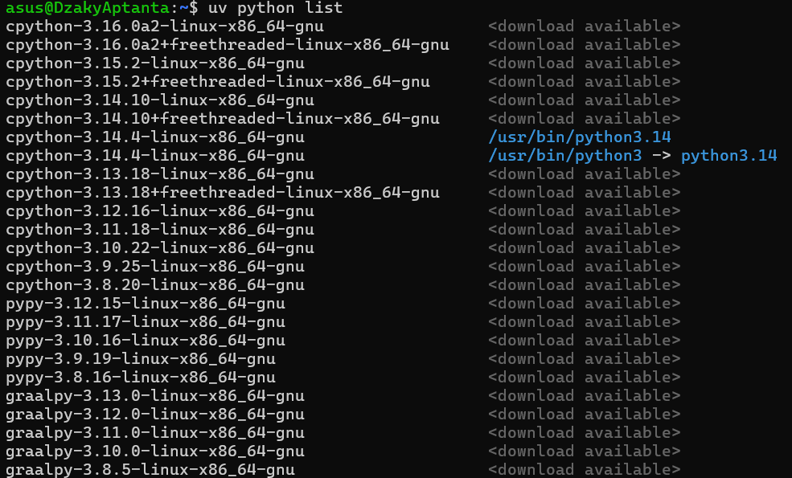

**Pembahasan:** Perintah `uv python list` menampilkan versi Python yang telah tersedia maupun yang dapat dipasang melalui `uv`. Pemeriksaan ini membantu memastikan interpreter yang dibutuhkan tersedia sebelum lingkungan proyek dibuat. Versi yang dipilih kemudian digunakan secara konsisten pada langkah berikutnya.

### Langkah 2 — Menetapkan versi Python proyek

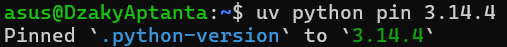

**Pembahasan:** Perintah `uv python pin` menetapkan Python 3.14.4 sebagai versi proyek dan mencatat pilihan tersebut pada konfigurasi versi lokal. Dengan demikian, perintah `uv` berikutnya dapat menggunakan interpreter yang sama, bukan bergantung pada versi Python global yang mungkin berbeda.

### Langkah 3 — Membuat dan mengaktifkan lingkungan virtual

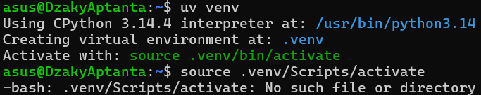

**Pembahasan:** Perintah `uv venv` membuat lingkungan virtual bernama `.venv` untuk memisahkan dependensi praktikum dari paket Python lain di komputer. Pada gambar, aktivasi dengan `source .venv/Scripts/activate` gagal karena jalur `Scripts` digunakan pada terminal Linux/WSL. Jalur aktivasi Linux/WSL yang sesuai adalah `source .venv/bin/activate`, sedangkan pada PowerShell Windows gunakan `.\.venv\Scripts\Activate.ps1`.

### Langkah 4 — Memasang dependensi aplikasi

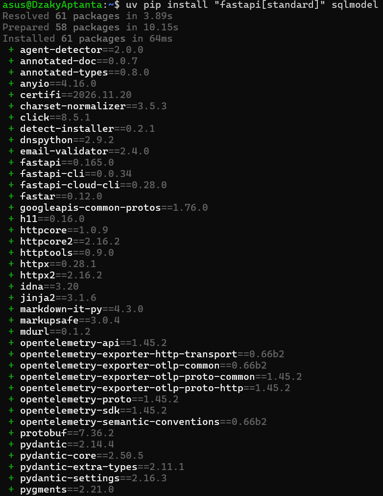

**Pembahasan:** Perintah instalasi memasang FastAPI beserta dependensi standarnya dan SQLModel ke lingkungan virtual yang telah dibuat. FastAPI digunakan untuk membangun endpoint HTTP, sedangkan SQLModel membantu mendefinisikan model data serta berinteraksi dengan basis data. Keluaran instalasi menunjukkan paket-paket berhasil dipasang.

### Langkah 5 — Memasang SQLite CLI

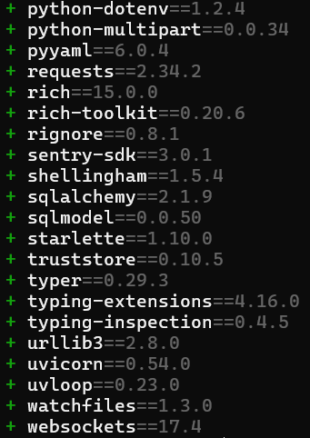

**Pembahasan:** Perintah pembaruan mengambil informasi paket terbaru, kemudian SQLite CLI dipasang agar basis data dapat dikelola langsung dari terminal. CLI tersebut digunakan pada langkah berikutnya untuk menjalankan perintah SQL, membuat tabel, menambahkan data, serta memeriksa hasilnya. Versi SQLite juga diperiksa setelah proses pemasangan.

### Langkah 6 — Membuat tabel dan data SDM

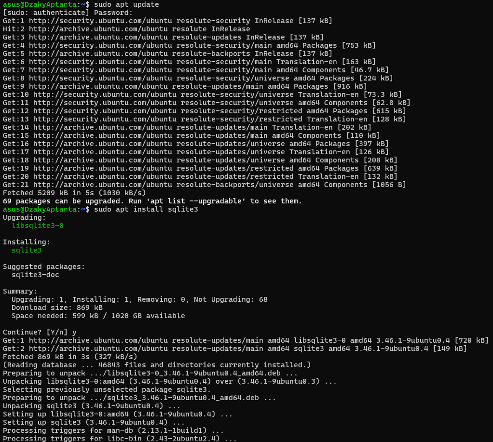

**Pembahasan:** Perintah SQLite membuka atau membuat berkas `departemen-sdm.db`, lalu membuat tabel `sdm` dengan `id` sebagai kunci utama serta kolom `npp` dan `nama`. Tiga baris data karyawan dimasukkan menggunakan perintah `INSERT`. Kueri `SELECT` menampilkan kembali data tersebut, sehingga penyimpanan awal dapat diperiksa sebelum diakses melalui API.

### Langkah 7 — Menulis layanan SDM

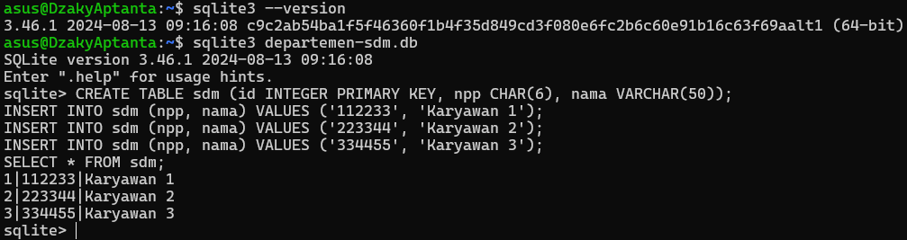

**Pembahasan:** Kode `service.py` mendefinisikan model `Sdm` yang menggambarkan kolom tabel, lalu membuat koneksi SQLModel ke `departemen-sdm.db`. Fungsi `get_session()` menyediakan sesi basis data untuk endpoint melalui `Depends`. Saat menerima `GET /sdm/`, endpoint menjalankan `select(Sdm)` dan mengembalikan seluruh hasil sebagai respons API.

### Langkah 8 — Memeriksa kode layanan SDM

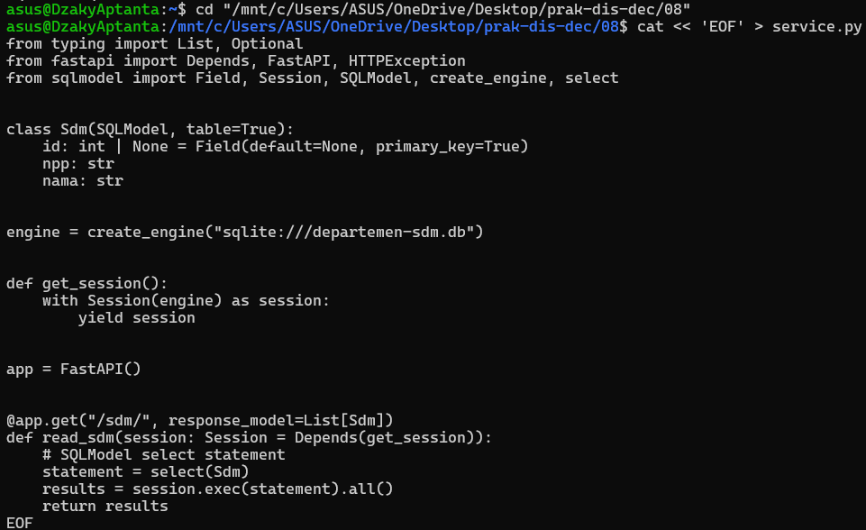

**Pembahasan:** Tampilan editor memperlihatkan struktur kode layanan SDM dengan lebih jelas, termasuk model, koneksi basis data, pengelolaan sesi, dan deklarasi endpoint. Model `Sdm` menghubungkan struktur data Python dengan tabel, sementara fungsi endpoint menerjemahkan permintaan HTTP menjadi kueri pembacaan. Pemisahan bagian-bagian ini membuat alur layanan lebih mudah ditinjau.

### Langkah 9 — Menjalankan dan menguji layanan SDM

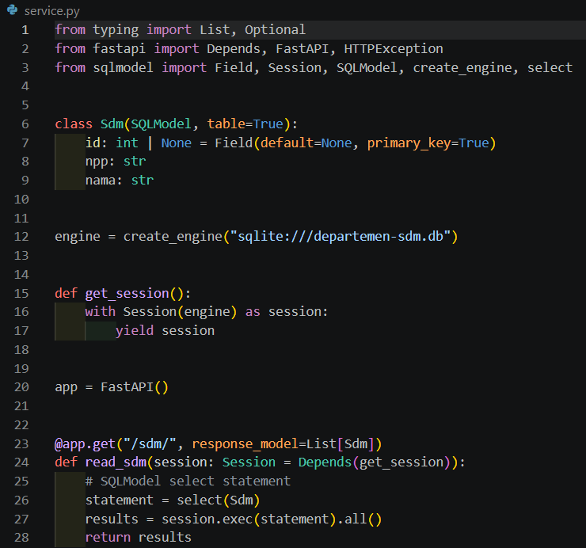

**Pembahasan:** Perintah Uvicorn menjalankan objek aplikasi `app` dari modul `service` pada alamat lokal dengan mode `--reload`, sehingga perubahan kode dapat dimuat ulang saat pengembangan. Log menunjukkan proses startup selesai dan permintaan ke `/sdm/` diterima. Status `200 OK` menandakan endpoint berhasil memproses permintaan tersebut.

### Langkah 10 — Menguji endpoint SDM dengan curl

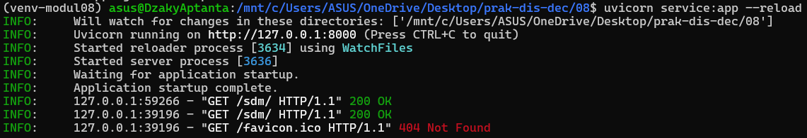

**Pembahasan:** `curl` mengirim permintaan HTTP GET ke `http://127.0.0.1:8000/sdm/` tanpa memerlukan browser. Respons yang tercetak berisi tiga objek karyawan dalam format JSON. Hasil ini memperlihatkan alur dari endpoint menuju kueri basis data dan kembali sebagai data yang dapat digunakan klien.

### Langkah 11 — Melihat respons SDM di browser

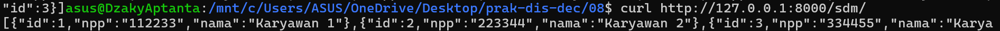

**Pembahasan:** Endpoint yang sama dibuka langsung di browser, yang mengirimkan permintaan GET ke server lokal. Browser menampilkan daftar karyawan sebagai JSON, sehingga isi respons dapat diperiksa secara visual. Hasilnya konsisten dengan pengujian melalui `curl`.

### Langkah 12 — Memeriksa kembali respons endpoint SDM

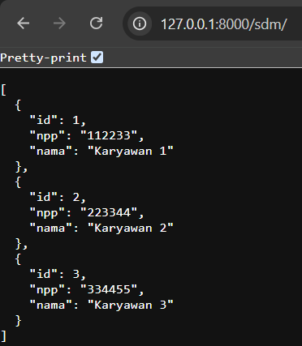

**Pembahasan:** Gambar ini mendokumentasikan tampilan respons `/sdm/` di browser. Tiga objek yang terlihat memuat nilai `id`, `npp`, dan `nama`, sesuai struktur tabel SDM. Respons tersebut menegaskan bahwa data yang dimasukkan ke SQLite dapat dibaca oleh endpoint.

### Langkah 13 — Menulis layanan mahasiswa

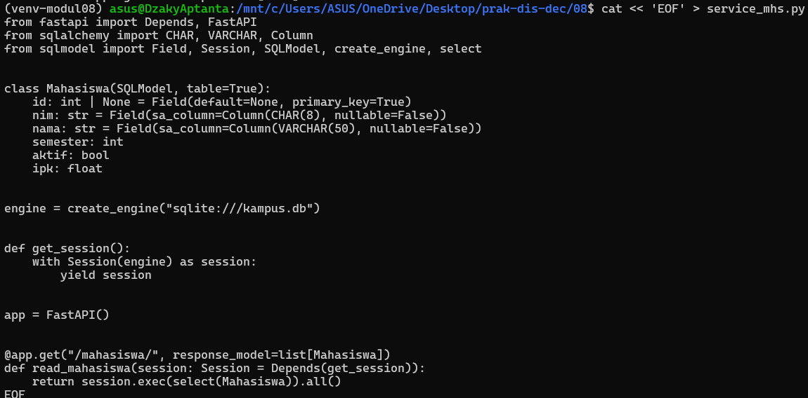

**Pembahasan:** Kode `service_mhs.py` membentuk layanan untuk domain mahasiswa, dengan model yang memuat NIM, nama, semester, status aktif, dan IPK. Koneksi diarahkan ke berkas `kampus.db`, terpisah dari basis data SDM. Endpoint `GET /mahasiswa/` menjalankan kueri untuk membaca data mahasiswa dari penyimpanan tersebut.

### Langkah 14 — Mengisi data awal mahasiswa

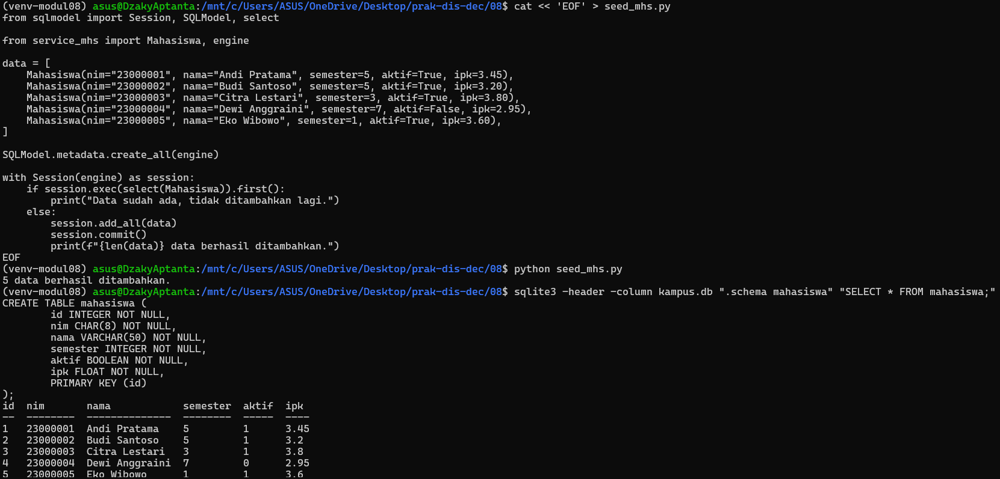

**Pembahasan:** Skrip `seed_mhs.py` membuat tabel berdasarkan model mahasiswa dan menyiapkan lima objek data contoh. Sebelum menambahkan data, skrip memeriksa apakah tabel telah berisi baris; pemeriksaan ini mencegah data contoh yang sama ditambahkan lagi saat skrip dijalankan ulang. Keluaran menyatakan lima data berhasil ditambahkan, kemudian SQLite CLI digunakan untuk melihat skema dan isinya.

### Langkah 15 — Memeriksa model dan endpoint mahasiswa

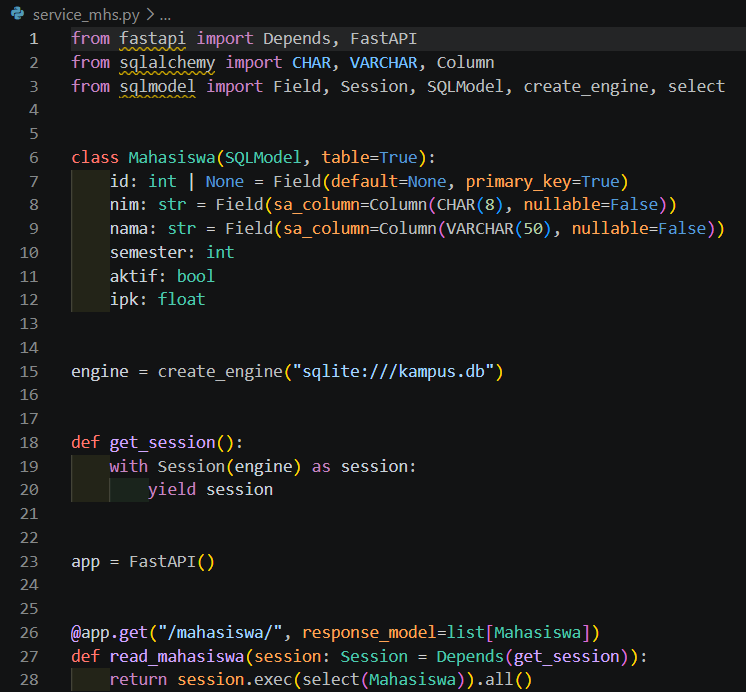

**Pembahasan:** Editor memperlihatkan tipe kolom dan aturan pada model mahasiswa, termasuk NIM dan nama yang wajib diisi. Pada endpoint, `select(Mahasiswa)` menyusun kueri untuk mengambil data dari sesi basis data. `response_model` membantu FastAPI menyajikan hasil sesuai struktur model sebagai JSON.

### Langkah 16 — Memeriksa skema dan isi basis data mahasiswa

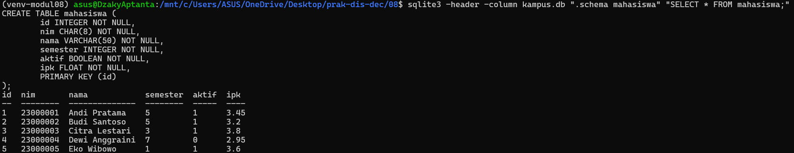

**Pembahasan:** Pemeriksaan melalui SQLite menampilkan definisi tabel `mahasiswa` dan lima baris yang telah dimasukkan. Kolom-kolom seperti NIM, nama, semester, status aktif, dan IPK sesuai dengan model pada layanan. Dengan memeriksa langsung basis data, hasil seeding dapat dipastikan sebelum endpoint diuji.

### Langkah 17 — Menjalankan layanan mahasiswa

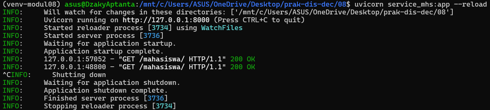

**Pembahasan:** Uvicorn menjalankan objek `app` dari modul `service_mhs` pada port lokal 8000. Log menunjukkan aplikasi selesai startup dan permintaan `GET /mahasiswa/` memperoleh status `200 OK`, yang berarti proses pembacaan data berhasil. Setelah pengujian, server dihentikan dengan proses shutdown yang tercatat pada log.

### Langkah 18 — Menguji endpoint mahasiswa dengan curl

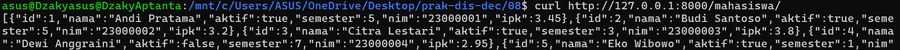

**Pembahasan:** Perintah `curl` mengirimkan permintaan ke endpoint `http://127.0.0.1:8000/mahasiswa/`. Respons memuat daftar lima mahasiswa dengan atribut yang tersedia pada model, seperti nama, NIM, semester, status aktif, dan IPK. Ini membuktikan endpoint dapat membaca data yang telah disiapkan pada `kampus.db`.

### Langkah 19 — Melihat respons mahasiswa di browser

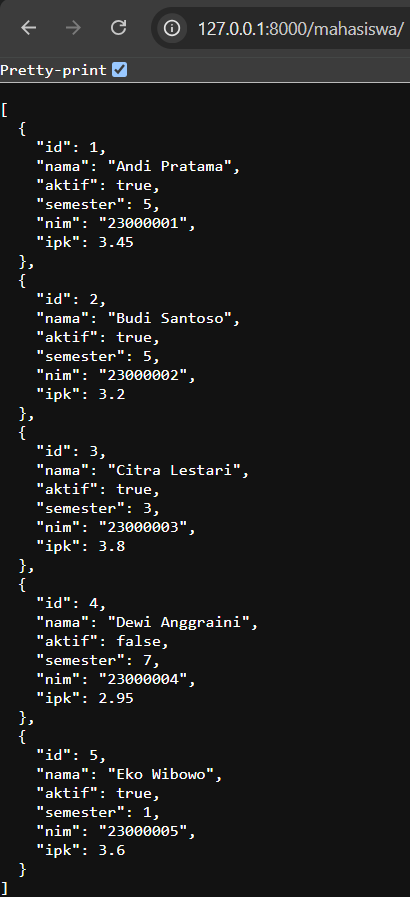

**Pembahasan:** Endpoint mahasiswa dibuka di browser untuk melihat respons API dalam bentuk JSON yang lebih mudah dibaca. Lima data mahasiswa beserta atributnya ditampilkan, termasuk data mahasiswa yang berstatus tidak aktif. Hasil ini sejalan dengan respons `curl` dan pemeriksaan isi tabel melalui SQLite.

## 4. Kesimpulan

Praktikum menunjukkan cara membuat API sederhana menggunakan FastAPI, menghubungkannya ke SQLite dengan SQLModel, dan menguji endpoint melalui `curl` serta browser. Layanan SDM dan mahasiswa memiliki model, endpoint, dan berkas basis data masing-masing sehingga memberikan contoh pemisahan tanggung jawab berdasarkan domain. Kedua endpoint berhasil mengembalikan data dalam format JSON dengan status `200 OK`. Praktikum ini memperkenalkan dasar microservices, sementara komunikasi antarlayanan dan deployment terpisah belum ditunjukkan pada langkah-langkah yang dikerjakan.
