# Laporan Praktikum: Instalasi dan Konfigurasi Git

## 1. Tujuan

Praktikum ini bertujuan untuk membahas proses instalasi perangkat lunak Git pada sistem operasi Windows serta konfigurasi awal yang diperlukan agar Git dapat digunakan secara optimal dalam pengelolaan proyek perangkat lunak. Selain itu, praktikum ini juga bertujuan untuk memastikan pengguna dapat melakukan aktivitas dasar seperti membuat repository, mencatat perubahan, dan berkolaborasi melalui platform seperti GitHub.

---

## 2. Landasan Teori

Git merupakan sistem kontrol versi terdistribusi yang berfungsi untuk mencatat setiap perubahan pada berkas proyek. Dengan Git, pengguna dapat melihat riwayat perubahan, mengembalikan versi sebelumnya, serta bekerja secara kolaboratif dalam satu proyek. Keunggulan utama Git adalah kemampuannya untuk mengelola perubahan secara efisien, menjaga integritas data, dan mempermudah kerja tim dalam pengembangan perangkat lunak.

---

## 3. Prosedur Praktikum

### 3.1 Persiapan instalasi

Langkah awal yang dilakukan adalah mengunduh installer Git dari situs resminya. Setelah file installer berhasil didownload, file tersebut dibuka untuk memulai proses instalasi.

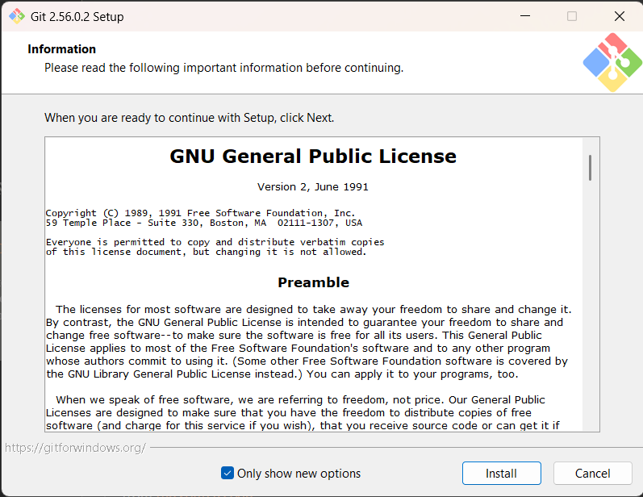

Pada tahap ini, pengguna menyiapkan file instalasi yang dibutuhkan agar proses pemasangan Git dapat berjalan tanpa hambatan.

### 3.2 Memulai proses instalasi

Setelah file dibuka, jendela installer akan muncul. Langkah berikutnya adalah menekan tombol “Next” untuk melanjutkan proses instalasi.

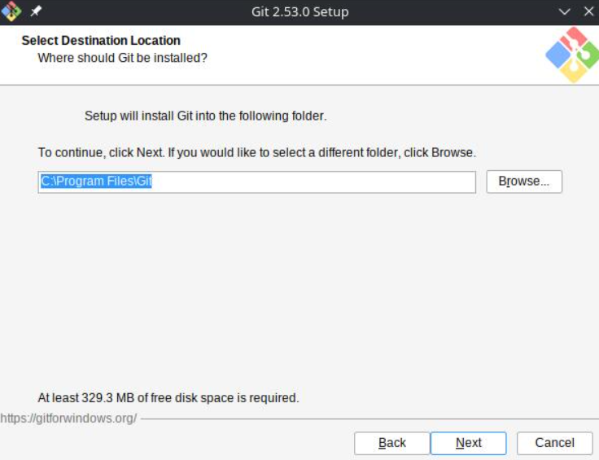

### 3.3 Persetujuan lisensi

Pada layar lisensi, pengguna diwajibkan membaca syarat penggunaan dan melanjutkan proses instalasi. Biasanya tombol “I Agree” akan tersedia setelah lisensi diterima.

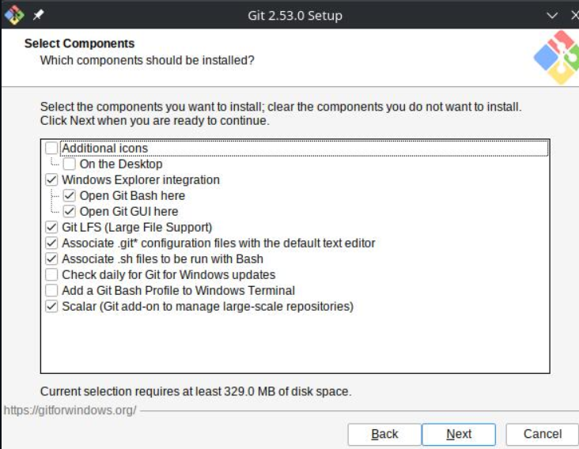

### 3.4 Pemilihan lokasi instalasi

Proses selanjutnya adalah menentukan folder tempat Git akan diinstal. Apabila tidak ada kebutuhan khusus, lokasi default yang disediakan oleh installer dapat digunakan.

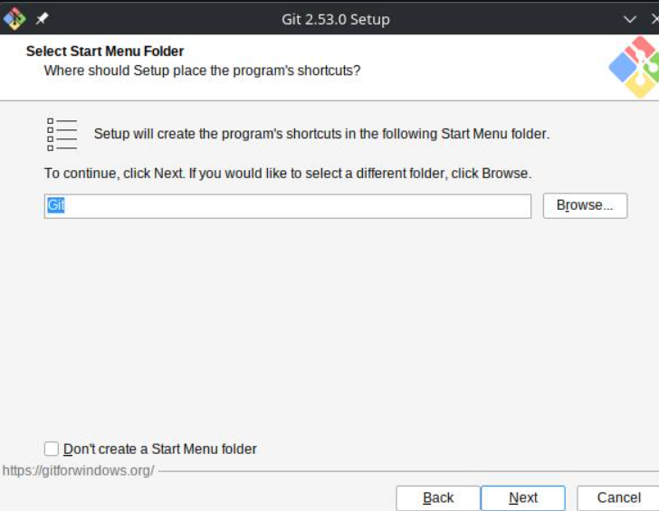

### 3.5 Pemilihan komponen

Pada tahap ini, pengguna memilih komponen yang akan dipasang. Untuk kebutuhan umum, opsi default yang disediakan oleh installer biasanya sudah sesuai dan direkomendasikan.

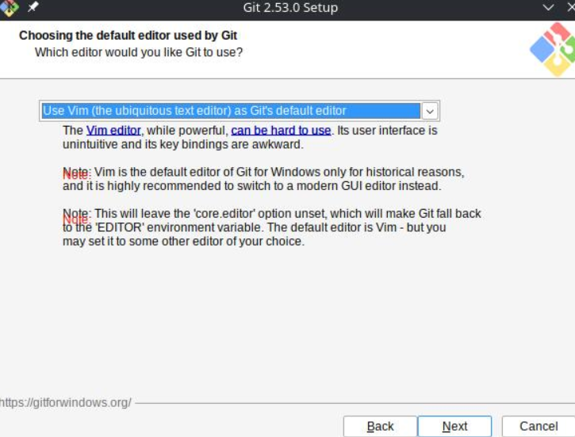

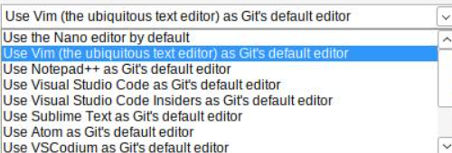

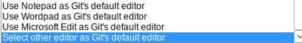

### 3.6 Pemilihan editor default

Git memerlukan editor default yang digunakan saat menulis pesan commit atau file konfigurasi tertentu. Pengguna dapat memilih editor yang sudah terpasang di komputer.

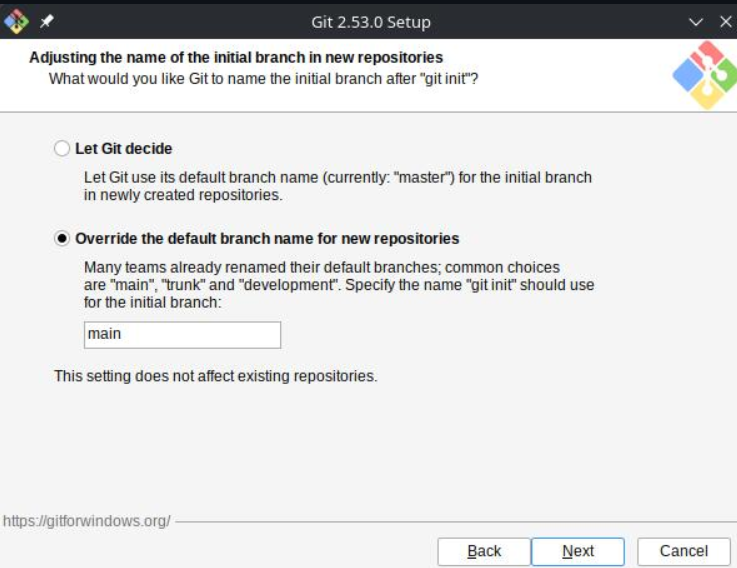

### 3.7 Pengaturan PATH environment

Pada bagian ini, Git diatur agar dapat diakses melalui terminal atau Command Prompt. Pengaturan default umumnya paling aman dan praktis untuk penggunaan umum di sistem Windows.

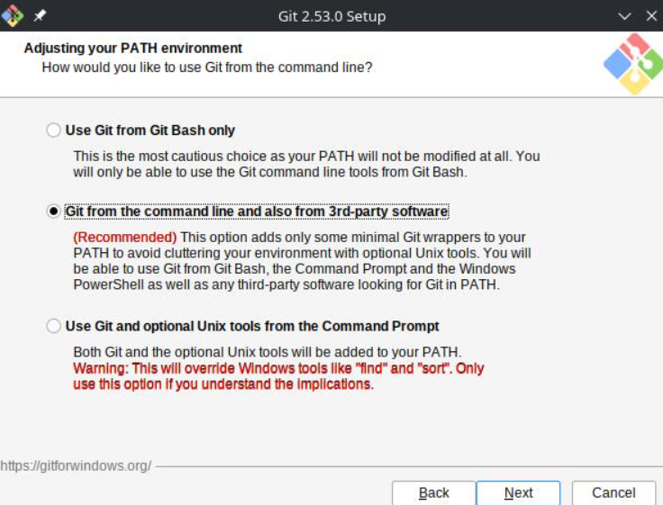

### 3.8 Pengaturan HTTPS transport

Tahap ini menentukan cara Git berkomunikasi saat mengakses repository melalui HTTPS. Pengaturan default yang ditawarkan biasanya sudah sesuai untuk kebutuhan umum.

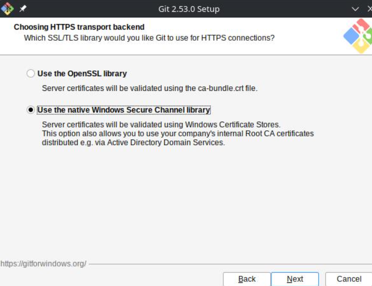

### 3.9 Pengaturan line endings

Git juga mengatur cara penanganan akhir baris pada file teks. Pengaturan default biasanya kompatibel dengan sistem Windows dan membantu mencegah masalah kompatibilitas antar platform.

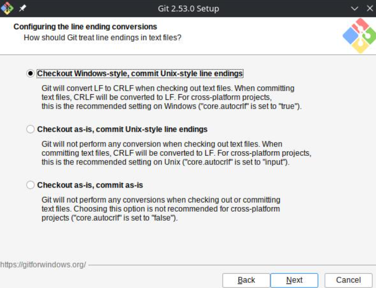

### 3.10 Pemilihan terminal

Git memerlukan terminal yang digunakan untuk menjalankan perintah. Pada Windows, biasanya terminal default yang dipilih sudah sesuai dan memudahkan pengoperasian Git.

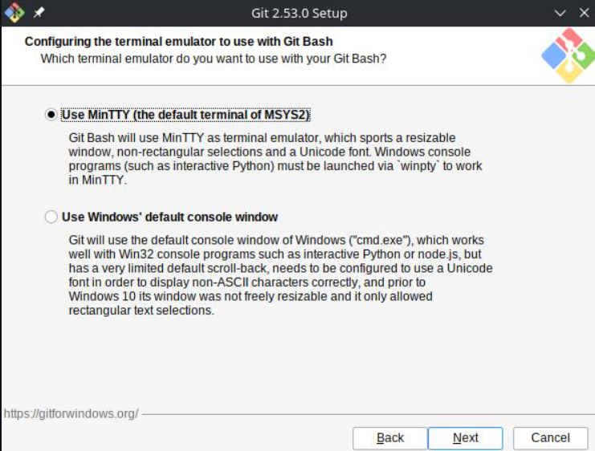

### 3.11 Opsi tambahan instalasi

Pada tahap ini, installer menampilkan opsi tambahan. Jika pengguna belum memiliki kebutuhan khusus, opsi default biasanya sudah cukup untuk proses instalasi yang aman dan optimal.

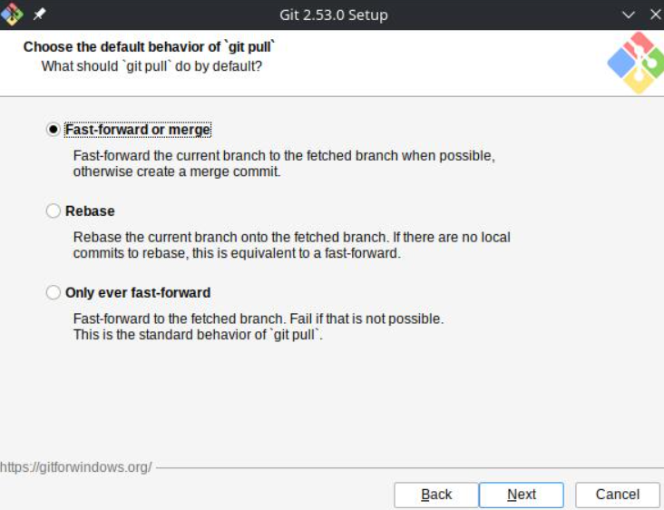

### 3.12 Proses instalasi berjalan

Setelah semua pengaturan ditentukan, installer mulai menyalin file ke komputer. Proses ini memerlukan waktu tertentu tergantung pada konfigurasi sistem.

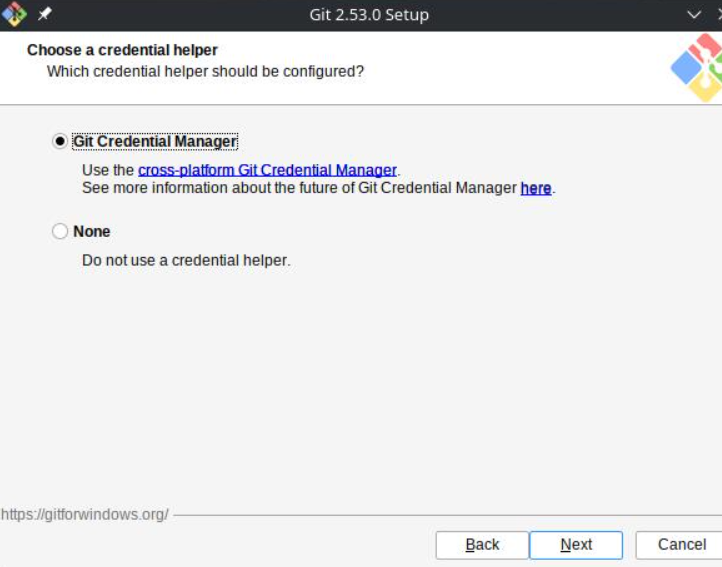

### 3.13 Penyelesaian instalasi

Ketika proses selesai, indikator instalasi berhasil akan muncul. Setelah itu, pengguna dapat menutup installer dan melanjutkan ke tahap verifikasi.

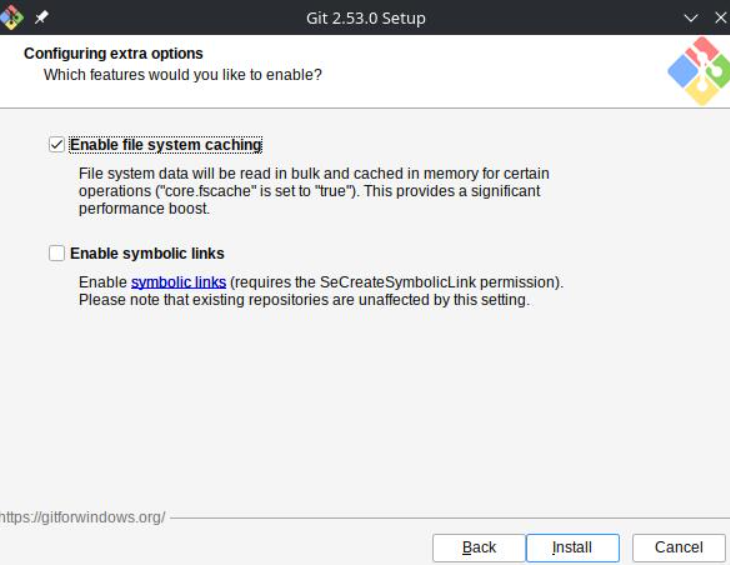

### 3.14 Verifikasi instalasi

Untuk memastikan Git telah terinstal dengan benar, dilakukan pengecekan versi menggunakan perintah berikut:

```bash
git --version
```

Perintah tersebut akan menampilkan versi Git yang terpasang pada sistem.

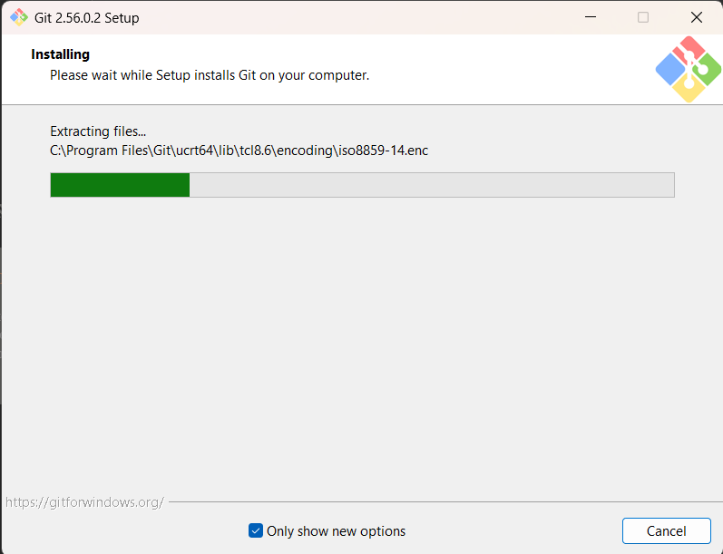

### 3.15 Pengujian terminal

Setelah verifikasi berhasil, terminal sudah dapat digunakan untuk menjalankan perintah Git dalam proses pengembangan proyek.

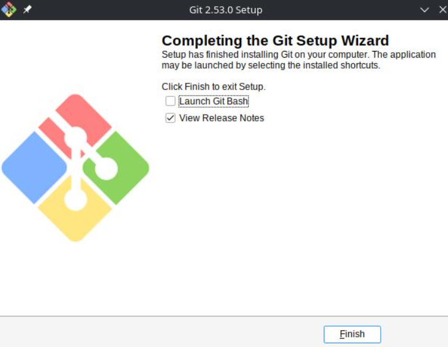

---

## 4. Konfigurasi Awal Git

Setelah proses instalasi selesai, tahap berikutnya adalah konfigurasi identitas pengguna agar setiap aktivitas commit tercatat dengan nama dan email yang benar.

### 4.1 Mengatur username

Perintah berikut digunakan untuk menetapkan nama pengguna secara global pada komputer:

```bash
git config --global user.name "Nama Anda"
```

Perintah ini memastikan setiap repository yang dibuat akan menggunakan nama yang sama pada setiap commit.

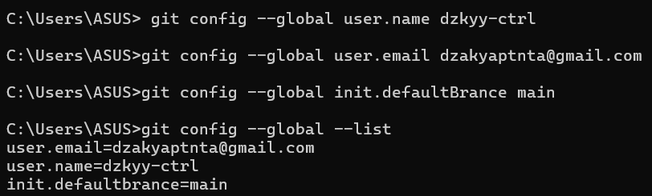

### 4.2 Mengatur email

Untuk mengatur alamat email pengguna, digunakan perintah:

```bash
git config --global user.email "email@anda.com"
```

Email ini akan otomatis terhubung dengan setiap commit yang dibuat oleh pengguna.

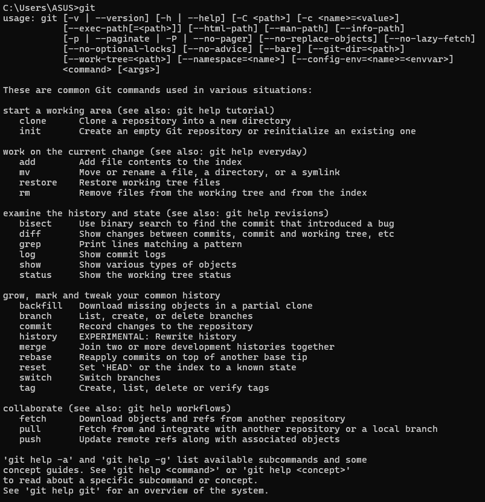

### 4.3 Mengecek konfigurasi

Untuk memastikan konfigurasi sudah benar, digunakan perintah berikut:

```bash
git config --list
```

Jika hasilnya menampilkan nama dan email yang sesuai, maka konfigurasi awal Git telah berhasil dilakukan.

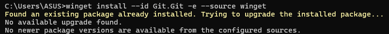

---

## 5. Hasil dan Pembahasan

Berdasarkan prosedur yang telah dilakukan, proses instalasi Git berhasil dilaksanakan dengan baik. Setelah instalasi, Git dapat dijalankan melalui terminal dan siap digunakan untuk mengelola repository. Adapun konfigurasi awal yang dilakukan juga berhasil dipasang dengan benar, sehingga identitas pengguna sudah terdaftar pada sistem Git.

Penerapan konfigurasi tersebut sangat penting karena setiap aktivitas commit akan mencatat nama serta email pengguna. Dengan demikian, proses kolaborasi dalam proyek perangkat lunak menjadi lebih tertata dan dapat dipertanggungjawabkan. Selain itu, hasil ini menandakan bahwa komputer siap untuk digunakan dalam pengembangan aplikasi yang memerlukan kontrol versi.

---

## 6. Kesimpulan

Dari praktikum ini dapat disimpulkan bahwa instalasi dan konfigurasi awal Git merupakan langkah penting dalam pengelolaan proyek perangkat lunak. Proses instalasi yang dilakukan sesuai tahapan memberi jaminan bahwa Git terpasang dengan benar dan dapat dijalankan secara optimal. Sementara itu, konfigurasi username dan email memastikan setiap perubahan yang dicatat dalam repository teridentifikasi dengan jelas.

Dengan demikian, pengguna telah siap untuk membuat repository baru, melakukan commit, serta berkolaborasi dengan tim melalui platform seperti GitHub atau GitLab. Keberhasilan pada tahap ini merupakan fondasi yang sangat penting dalam kegiatan pengembangan perangkat lunak berbasis kolaborasi.

---

Laporan Praktikum Git 2026
